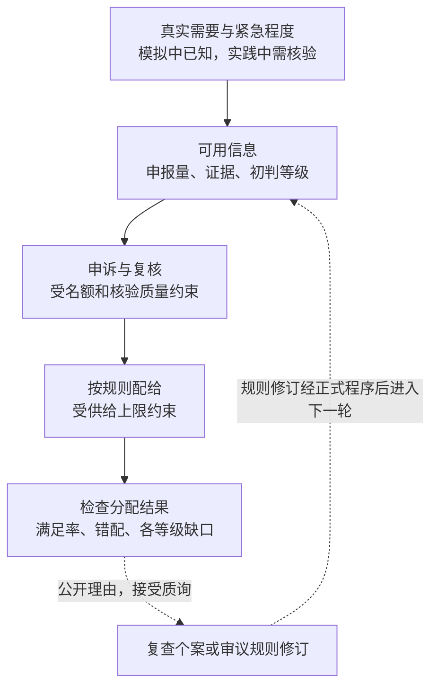
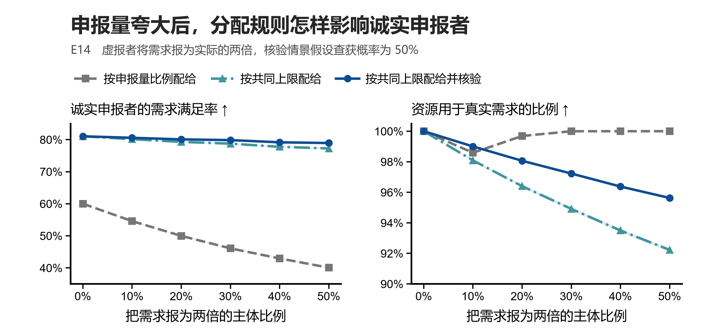
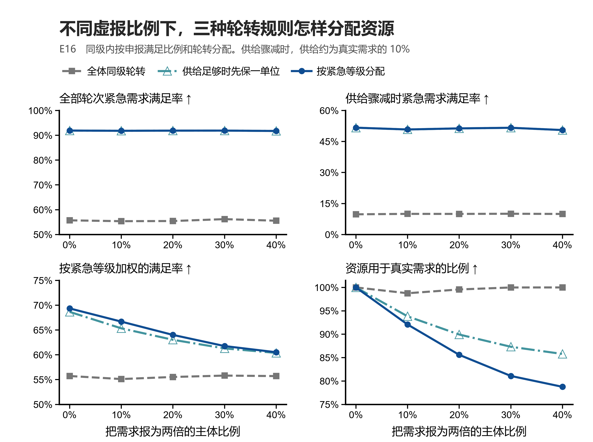
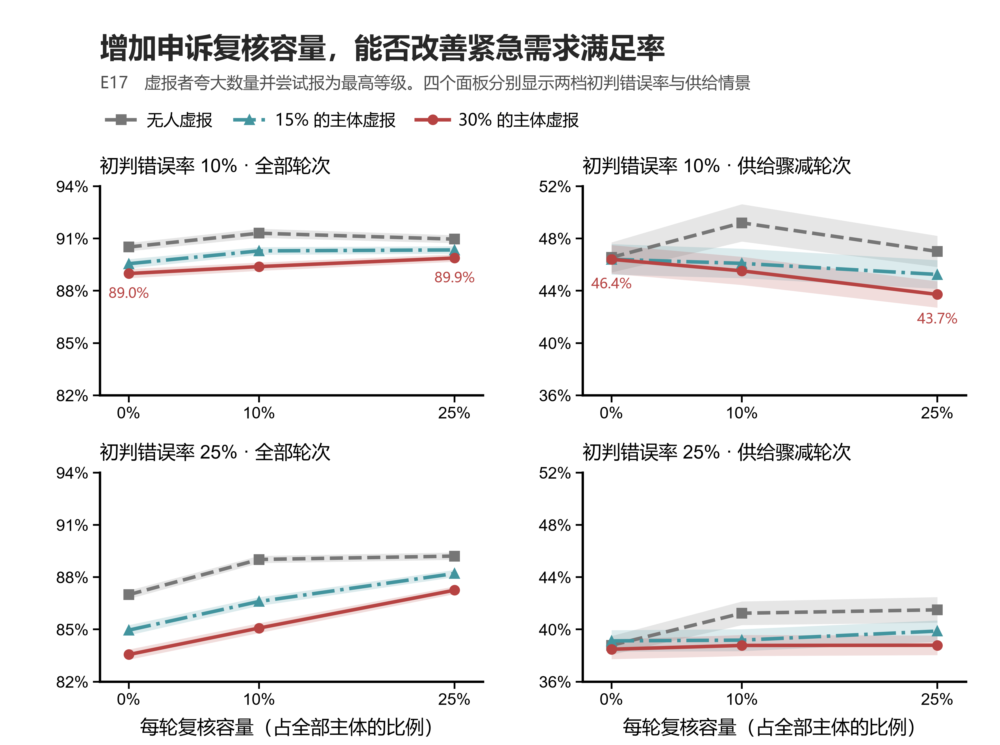
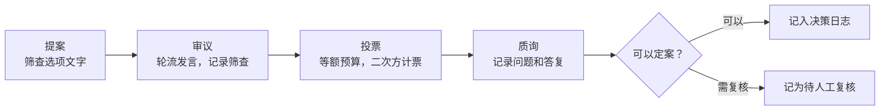
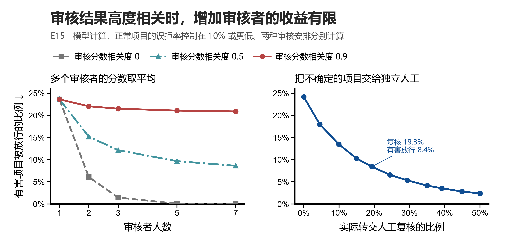

# PoL2 公共化治理实验室（AI主动管理-区别于当前的审核模式-协议化） 

> 第一、主动管理了解“虚假申报”的心理动机，了解足够的信息之后再做出审核决策；沟通的过程中解决掉“虚假申报”的动机。
> 第二、分配后管理。跟踪配给真实消耗，基于IoT的智能反馈；信息透明的导向应当是“虚假行为”减少;
> 第三、抛弃掉当前管理模式的弊病。在管理中，需要考虑“无惩罚管理/引导”；需要考虑在转型早期，确定系统的容错性，不用仇恨治理；
> 第四、强大而缜密的仇恨。当事人事实上有一个合理的诉求（主观视角上的逻辑路线），这是需要被巧妙地被结构/理解的。当匮乏被解决之后，问题就会消解。
> 富爱文明的管理核心——“**让所有人回到正确的认知里**”。 “创造性接纳”目标“用爱2解决对方的认知偏差”。
> ......

[简体中文](README.md) · [English（原版）](README.en.md) · [实验结果](docs/results.md) · [复现方法](#运行与复现)

在爱2证明所设想的富爱文明中，生产公共化为公共品时代提供制度基础。部分公共资源和服务仍会受到数量、可用时段或交付能力的限制。供给不足时，按需分配要解决的第一个问题是凭什么认定需求，接着才是哪些需求应优先、同等级的需求如何分配。若需求量或紧急程度被判错，谁能提请复核，纠正后又会改变谁的份额？分配结果和参与者的反馈，也为检验和修订规则提供依据。

爱2证明（Proof of Love2，PoL2）第六章把生产资料、技术工具和数据纳入共享的公共基础设施，规定按合理需求平等、无偿地享用公共生产成果，并以不可交易的通证记录资源用量。第七章讨论公共福利决策如何自治，怎样接受建议、质询和监督，以及怎样留下可核验的理由。第四章的平等联结和扬爱抑恨则给出审议中的行为原则。这里研究的是有限供给下的分配规则和参与程序，生产资料确权、生产计划和真实需求识别属于更大的公共化议题。 [第六章·生产公共化](https://github.com/naturaldao/NaturalDAO/blob/main/PoL/6.%20%E5%AF%8C%E7%88%B1%E6%96%87%E6%98%8E%E7%94%9F%E4%BA%A7%E5%85%AC%E5%85%B1%E5%8C%96%E5%8D%8F%E8%AE%AE.md) · [第七章·公共福利治理](https://github.com/naturaldao/NaturalDAO/blob/main/PoL/7.%20%E4%BA%BA%E7%B1%BB%E5%85%AC%E5%85%B1%E7%A6%8F%E5%88%A9%E7%9A%84%E6%B2%BB%E7%90%86%E5%8D%8F%E8%AE%AE.md) · [第四章·伦理对齐](https://github.com/naturaldao/NaturalDAO/blob/main/PoL/4.%20PoL2%E4%B9%8B%E4%BC%A6%E7%90%86%E5%AF%B9%E9%BD%90%E5%8D%8F%E8%AE%AE.md)

## 团队需要先议定的五件事

| 议题 | 会上要定什么 | 怎样判断规则是否管用 |
| --- | --- | --- |
| **试点资源与需求证据** | 先选哪一种可计量的公共资源？哪些证据足以认定需求和紧急程度？证据难以取得的人能怎样补充说明？ | 比较各群体的申请完成率、需求满足率及核验负担。 |
| **短缺时的分配次序** | 供给允许时是否先保基本用量？极端短缺时先保谁，同级如何轮转，未满足的需求是否结转？ | 分别报告常态与冲击轮次的各等级满足率，并观察长期等不到资源的人。 |
| **申诉与复核** | 谁能提出复核，谁核验，多久答复？名额不足时随机抽取、按紧急程度排序，还是为特定情形保留名额？怎样纠正初判过高？ | 同时记录应纠未纠、误批、等待时间，以及改判后各等级获配量的变化。 |
| **最终裁决权** | 人类提供意见和证据之后，谁负责认定事实、解释适用规则、暂停执行与最终裁决？人工复核的结论有多大约束力？ | 让同一争议案例经过两套权限安排，核对决定、理由和问责路径是否清楚。 |
| **公开与核验** | 规则、资源流向、决策理由如何公开？敏感证据和逐人选票怎样核验，查看权限和留存期限由谁决定？ | 检验独立复核者能否重建决定及其适用的规则版本。 |

## 公共化下的权利、优先次序与责任

PoL2 的公共化关乎生产资料怎样组织、成果怎样取得。经济学区分物品时，则看排除他人使用的难度，以及一人的使用会减少多少留给他人的可用量。公开知识的复制通常很少挤占他人的使用机会。难以排除使用者、用量又会相互挤占的水源，是典型的共同池资源。可以设定准入条件的公共服务，若容量不足也会排队。实验室把供给量作为给定条件，研究用量会相互挤占的公共资源。 [Ostrom 的物品分类](https://www.nobelprize.org/prizes/economic-sciences/2009/ostrom/lecture/)

第六章第 5、6、11 条分别涉及资源核算、公共需求与平等享用。把它们写成分配规则，需要区分**平等的享用资格**和**按需要确定的用量**。同级轮转回答相近需求怎样同等对待，紧急优先回答不同程度的需求为什么要区别对待，跨轮最低保障关心同一申请者是否长期被排在后面。供给已经用尽时，增加某组的份额会压缩其他用途的份额。第七章第 1 条的福利权利确立了制度目标，E16 的一单位保障是可比较的实验规则。

程序层面的要求同样具体。依据第四章 4.3.1–4.3.3，参与资格和人格尊严应平等，筛查针对具体行为。第七章要求保留数据来源、推理步骤和伦理依据，并允许人类提出建议、质询和监督。个案复核可以补正某次需求认定。若要改变紧急等级标准或分配顺序，按第七章第 11 条还涉及公开质询、EAP 验证和版本归档。哈希校验可以检查记录的完整性。决定是否公允还要看理由能否经受质询、错误能否实际更正。 [条款与实现对照](docs/concept-mapping.md) · [Daniels 关于理由公开与复议的论述](https://pmc.ncbi.nlm.nih.gov/articles/PMC1119050/)



*图 1　按需分配的制度框架。实线对应申报、分类、复核和分配的研究环节。虚线表示需要进一步设计的反馈与修订程序。现有模拟按预设规则运行。*

## 需求虚报怎样转移短缺

若第 $i$ 位申请者申报 $r_i$，总供给 $S$ 低于总申报量，按申报比例分配就给他 $S r_i / \sum_j r_j$。设真实总需求为 $D$，供给为 $sD$，虚报者占**真实总需求**的比例为 $q$，并把自己的需求报成 $k$ 倍。诚实申报者的真实需求满足率 $a$ 为

$$
a=\frac{s}{1+(k-1)q}.
$$

只要 $k>1$，虚报群体所占的需求份额越大，诚实者的满足率越低。虚报者拿到真实需求的 $ka$ 倍。在 $ka\leq 1$ 时，即使所有已分配资源都用于真实需求，诚实者也已让出一部分份额。例如，取 $s=0.6$、$q=0.3$、$k=2$，诚实者的满足率约为 46.2%，虚报者约为 92.3%，两组收到的资源仍都能用上。这里的 $q$ 是需求份额。E14 对每位申请者按同一概率设定是否虚报，人数与需求的份额在单次模拟中可能不同。

E14 另两条规则采用随供给调整的共同上限 $\lambda$，每人得到 $\min(r_i,\lambda)$。当某人的申报已高于上限时，再抬高申报也无法增加其份额。该规则对虚报的敏感度较低，但仍可能把一部分资源发到实际需要之外。事前核验针对的是这部分偏差。



*图 2　需求虚报对三种规则的影响（E14，合成模拟）。按申报量比例分配时，30% 的申请者把数量报成两倍，诚实者满足率从约 60% 降到 46%，实际使用率仍接近 100%。同一申报条件下，封顶和事前核验减轻了诚实者的损失，实际使用率也随规则而变。核验在模型中按设定概率纠正虚报，无成本、无延误。* [结果表](results/tables/e14_needs_report.csv)

## 紧急优先与基本保障怎样分担短缺

E16 模拟 120 名申请者、24 轮分配。每人每轮需要 1–8 个不可拆分单位，普通轮次供应约为总真实需求的 65%，每第六轮降到 10%。规则在同一级别内优先照顾申报满足比例最低的人，比例相同则按轮转次序。三种方案分别采用全体同级、需求分级，以及在分级前尽可能普发一个单位。

若一轮有 $N$ 人申请，普发一个单位至少需要 $N$ 个单位的供给。E16 的冲击轮最多只有 $0.1\times 8N=0.8N$ 个单位，因此该轮的普发步骤不会启动，会直接按紧急程度分配。公共保障若要在这种情况下仍有可执行的内容，团队就要事先议定缩减次序或跨轮补偿。若未来改为需求逐次到达、已发资源难以收回，可以用 Manshadi 等人的动态配给研究作为另一个基准。 [Fair Dynamic Rationing](https://arxiv.org/abs/2102.01240)



*图 3　不同短缺指标会给出不同的规则排序（E16，合成模拟）。无人虚报时，紧急优先把紧急组跨轮满足率从约 56% 提高到 92%，冲击轮从约 10% 提高到 52%。40% 的申请者虚报数量时，可行时先保一单位的方案把真实需求使用率从约 79% 提高到 86%，紧急组满足率仍约 92%，总体优先级加权满足率约 60%。加权结果采用紧急、重要、一般为 3∶2∶1 的权重。现有结果表没有分别报告后两组的满足率。* [结果表](results/tables/e16_nonmarket_allocation.csv)

## 申诉能救回多少需求，取决于复核的对象和时点

E17 在 E16 的基本保障规则上加入初判和复核。初判可能错到相邻等级，部分申请者也会夸大数量并尝试申报最高等级。复核前从申诉者中随机抽取案件。若同轮有 $T$ 件真实低估申诉、$F$ 件虚假升级申诉，且 $T+F>0$，名额 $K$ 对应的单件受审概率为 $p=\min(1,K/(T+F))$。按实验设定，预计纠正 $0.90pT$ 件，误批 $0.05pF$ 件。扩大名额会让两类案件都更容易被审到，最终影响还取决于改判者进入了哪个队列，以及本轮供给能覆盖多少高优先需求。



*图 4　复核的平均效果与短缺时的效果可能方向不同（E17，合成模拟）。在初判错误率 10%、30% 的申请者可尝试虚报的情景中，每轮复核上限从 0 增至全体的 25%，紧急组跨轮满足率约从 89.0% 到 89.9%，冲击轮则从 46.4% 到 43.7%。初判错误率改为 25% 时，同样的容量变化使跨轮满足率约从 83.6% 到 87.3%，冲击轮约从 38.5% 到 38.8%。这些是情景均值，阴影为各条件均值的 95% 蒙特卡洛置信区间。* [结果表](results/tables/e17_priority_appeals.csv)

复核结果还需要与错配一起看。在上述 25% 初判错误、30% 可虚报情景里，总体加权满足率仍约 59%，分给有效等级高于真实等级者的资源占比从约 21.4% 到 21.9%。该指标把初判高估与复核误批都计入。当前程序只受理向上申诉，尚未模拟主动下调过高等级、复核延误或申诉结果跨轮积累。检验不同复核顺序时，应同时看错过多少紧急案件、谁承担等待，以及实际分配如何变化。 [单一情景的三项结果](results/figures/readme_publicization_appeals_zh.png) · [实验结果与假设](docs/results.md)

## 公共决策怎样听取偏好

第六章的通证用于核算资源使用。下面 DAO 投票中的代币是试验内的偏好表达额度。以「AI 是否记住用户偏好」为例，原型让参与者轮流发言、用相同预算投票、在计票后提出质询。二次方计票按个人在每个选项上投入的代币数开平方，再按选项加总。伦理对齐协议（EAP）的筛查依据文本，标记后保留原文并提供修复提示，发言者仍可参与审议、投票和质询。 [条款、代码和测试对照](docs/concept-mapping.md)



*图 5　DAO 会话原型。质询未答复、领先选项未通过筛查或平票时，标记为待人工复核。决策日志记录数据来源、计票步骤和伦理依据。哈希校验可检出破坏链内一致性的改动，核对整份日志是否被替换还需要可信的外部链头。*

第七章第 2、10 条把公共福利决策和争议裁决交给 NaturalDAO，第 8、9 条规定人类如何提出建议、质询和监督。原型把人类投票作为输入，并在特定情形标记为待人工复核。复核的受理与裁决仍需另行定义。E7 另行模拟公共 AI 根据申报偏好直接决策，结果对申报是否诚实敏感。 [自治与投票的条款对照](docs/concept-mapping.md#尚未解决的问题)

**真人选票的重算。** Sharma 等人的 177 人随机实验比较了线性和二次方计票、等额和 20/80 预算。20/80 指 20% 的参与者持有 80% 的代币。第一轮线性计票的 20/80 组有 25 人，「使用额外用户信息」实际胜出。若保持每人投给各选项的预算比例，仅统一预算，「追踪并应用用户偏好」在重算中领先第二名 2.05 个百分点，第二轮的胜者则未变。重算依赖分配比例不变的假设。要在二次方规则下做同样的重算，需要逐张选票。 [Sharma 等人的论文](https://doi.org/10.1038/s41598-026-40180-8) · [数据来源](data/README.md) · [重算结果](results/tables/published_equal_budget_counterfactual.csv)

**发言与筛查的模拟。** E0 设 25 人一组，其中 5 人强烈偏好同一选项。模拟假定敌意会让少数派更少发言，也假定发言会改变他人的偏好。有敌意时，等额预算和二次方计票之上加入轮流发言，少数派发言份额约从 12% 回到 20%，其首选胜出率由约 35% 升到 68%。在无敌意的一组模拟里，筛查误标少数派的批评，按模型规则使这部分发言失去说服权重。 [实验设计](docs/experiment-design.md) · [E0 结果表](results/tables/e0_decomposition.csv)


*图 6　投票和审议规则的逐步比较（E0，合成模拟）。加入筛查后，有敌意情景的胜出率由约 68% 到 76%，无敌意情景由约 70% 到 62%。这里的少数派首选恰好是模型中按人等权计算的总效用最高选项。*

原型默认用关键词规则演示筛查。E9 的预先编写词表漏掉了公开合成试例中的 9 条候选违规，E10 另检验了引用、否定和隐晦敌意。身份核验尚未实现，E6 中一人多号会放大开方计票的影响。 [筛查与身份实验](docs/results.md) · [替换判定器的示例](examples/custom_judge.py)

## 怎样让复核提供独立判断

第七章第 6 条要求对公共福利提案做伦理验证。E15 以审核项目是否有害为对象，比较了增加审核者与把不确定案件转交独立复核两种做法。假定 $n$ 个审核者的评分噪声方差都为 1，任意两人的评分噪声相关度为 $\rho$，平均分中的噪声方差就是 $\rho+(1-\rho)/n$。增加审核者可以摊薄各自独有的误差，共同误差仍留在平均分里。



*图 7　审核独立性和复核容量（E15，模型计算）。把正常项目的误拒率限制在 10% 左右时，评分噪声相关度设为 0.9，取七位审核者的平均分，模型中的有害项目放行率只从约 23.6% 降到 20.9%。右图是另一种安排，按分数区间把约 19.3% 的案件转给假定独立且更有辨别力的人工审核者，有害项目放行率约为 8.4%。这两组结果使用假定的判别力和误差结构。* [相关性结果表](results/tables/e15_reviewer_correlation.csv) · [复核结果表](results/tables/e15_escalation.csv)

对公共化制度而言，复核是否独立取决于能否补充或重新核对关键证据，以及复核者是否与初判共享同样的盲点。第七章第 9 条对决策数据和日志的访问提出广泛要求。遇到敏感证据时，分级访问的适用范围、谁能调阅原始证据和公众可见的决定理由，仍需明确。这项安排也应接受质询。

## 运行与复现

需要 Python 3.10 或更高版本。进入本实验室目录后，在所用的 Python 环境中安装。核心会话使用标准库，`.[dev]` 另外安装测试和绘图库。

```sh
git clone https://github.com/naturaldao/NaturalDAO-2nd.git
cd NaturalDAO-2nd/PoL-Governance/research/PoL2-DAO-Governance-Lab
python -m pip install -e ".[dev]"

pol2dao demo
pol2dao verify results/demo_decision_chain.jsonl
pol2dao published
pol2dao simulate --reps 1000
pol2dao experiments --only E14,E16,E17 --reps 500
pol2dao experiments --reps 1000
python -m pytest
```

[OSF 原始选票](https://osf.io/q6snh/) 单独提供。下载后可用 `pol2dao replay --data-dir path/to/osf-files` 逐票重算并检查重抽样稳定性。

安装中文字体后，运行 `python scripts/build_readme_figures_zh.py` 可从现有结果表重绘中文统计图。E14、E17 和 E0 的阴影来自原实验给出的 95% 模拟置信区间，E16 显示情景均值，E15 由模型计算得到。 [图 2 PDF](results/figures/readme_publicization_needs_sensitivity_zh.pdf) · [图 3 PDF](results/figures/readme_publicization_allocation_sensitivity_zh.pdf) · [图 4 PDF](results/figures/readme_publicization_appeals_sensitivity_zh.pdf) · [图 6 PDF](results/figures/readme_publicization_voice_zh.pdf) · [图 7 PDF](results/figures/readme_publicization_oversight_zh.pdf)

- [实验图集 E0–E17](docs/results.md) 收录各实验的设定、图表与证据边界。
- [实验设计](docs/experiment-design.md) 说明行为假设、对照条件和指标。
- [条款对照](docs/concept-mapping.md) 列出对应的代码、测试和开放问题。
- [数据说明](data/README.md) 区分论文统计、独立复算、公开合成试例和项目自编语料。

## 来源与许可

- 爱2证明理论见 [NaturalDAO 主仓库](https://github.com/naturaldao/NaturalDAO)。实验所用公开试例和文献综述数据来自其 `PoL-Governance/`，复制于 `30f1ad6`，沿用其 CC0-1.0 数据许可。
- Sharma, T. et al. (2026). *Democratic governance through DAO-based deliberation and voting for inclusive decision making in AI models*. Scientific Reports 16, 11792. [原论文](https://doi.org/10.1038/s41598-026-40180-8) · [选票汇总复算](https://github.com/shentonyan/dao-governance-replication)。
- 引用实验室请见 [CITATION.cff](CITATION.cff)。本实验室原创代码与文档按 [Proof of Love2](LICENSE) 声明许可。历史版本已授予的 MIT 权限继续有效，外部数据与论文沿用各自许可。
