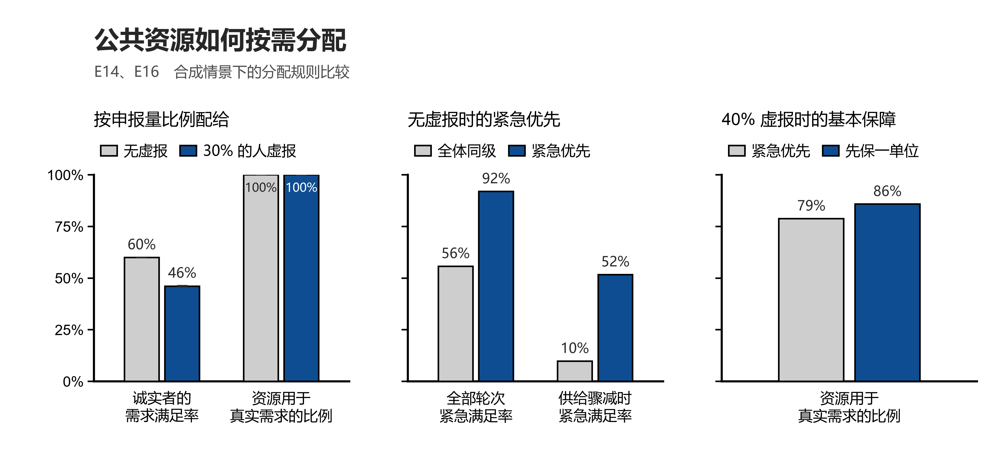
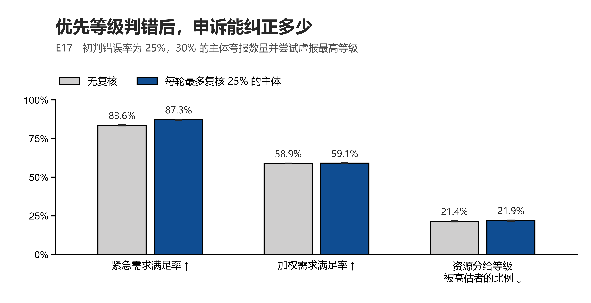
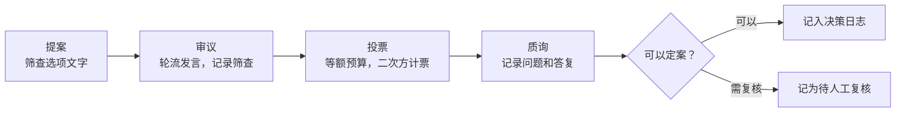
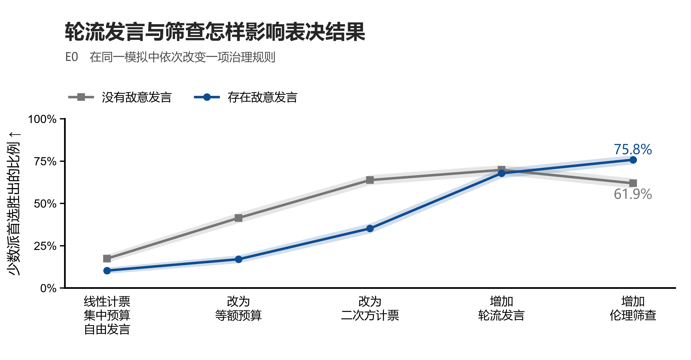

# PoL2 公共化治理实验室

[简体中文](README.md) · [English（原版）](README.en.md) · [实验结果](docs/results.md) · [复现方法](#运行与复现)

在爱2证明所设想的富爱文明中，生产公共化为公共品时代提供制度基础。部分公共资源和服务仍会受到数量、可用时段或交付能力的限制。供给不足时，按需分配要解决的第一个问题是凭什么认定需求，接着才是哪些需求应优先、同等级的需求如何分配。若需求量或紧急程度被判错，谁能提请复核，纠正后又会改变谁的份额？分配结果和参与者的反馈，也为检验和修订规则提供依据。

爱2证明（Proof of Love2，PoL2）第六章把生产资料、技术工具和数据纳入共享的公共基础设施，规定按合理需求平等、无偿地享用公共生产成果，并以不可交易的通证记录资源用量。第七章讨论公共福利决策如何自治，怎样接受建议、质询和监督，以及怎样留下可核验的理由。第四章的平等联结和扬爱抑恨则给出审议中的行为原则。这里研究的是有限供给下的分配规则和参与程序，生产资料确权、生产计划和真实需求识别属于更大的公共化议题。 [第六章·生产公共化](https://github.com/naturaldao/NaturalDAO/blob/main/PoL/6.%20%E5%AF%8C%E7%88%B1%E6%96%87%E6%98%8E%E7%94%9F%E4%BA%A7%E5%85%AC%E5%85%B1%E5%8C%96%E5%8D%8F%E8%AE%AE.md) · [第七章·公共福利治理](https://github.com/naturaldao/NaturalDAO/blob/main/PoL/7.%20%E4%BA%BA%E7%B1%BB%E5%85%AC%E5%85%B1%E7%A6%8F%E5%88%A9%E7%9A%84%E6%B2%BB%E7%90%86%E5%8D%8F%E8%AE%AE.md) · [第四章·伦理对齐](https://github.com/naturaldao/NaturalDAO/blob/main/PoL/4.%20PoL2%E4%B9%8B%E4%BC%A6%E7%90%86%E5%AF%B9%E9%BD%90%E5%8D%8F%E8%AE%AE.md)

## 团队需要先议定的五件事

| 议题 | 会上要定什么 |
| --- | --- |
| **试点资源与需求证据** | 先选哪一种可计量的公共资源？什么算合理需求，哪些情况可列为紧急，申请者用什么证据说明？ |
| **短缺时的分配次序** | 供给足以普发一个单位时，是否先给每位申请者一份？连这一份都不够时先保谁？同等级如何轮转，上一轮未满足的需求是否结转？ |
| **申诉与复核** | 谁独立复核、多久答复、每轮能审多少件？谁可以纠正初判过高的等级？复核挤占的份额如何记录？ |
| **最终裁决权** | 人类投票供公共 AI 参考，还是对结果有约束力？当票数、伦理筛查和质询指向不同结论时，谁能暂停执行，谁能改判？ |
| **公开与核验** | 哪些分配规则、资源流向和理由可以公开？谁可查看敏感的需求证据和逐人选票？用什么指标判断试点是否达到预期？ |

## 按需分配先要知道需求

**申报量和真实需要可能不同。** E14 将需求申报当作输入。30% 的主体把需求报成两倍时，按申报量比例分配，诚实者的需求满足率由约 60% 降至 46%，资源用于真实需求的比例却仍接近 100%。多分给夸大者的资源仍可被他们的真实需求吸收，只统计资源是否用掉，会漏掉诚实申报者的损失。实验还比较了封顶和事前核验，核验在模型中没有成本。 [E14 结果与假设](docs/results.md) · [结果表](results/tables/e14_needs_report.csv)

**短缺时，要明确让哪一类需求先得到满足。** E16 用 120 个合成需求单位模拟 24 轮分配，普通轮次供给约为当轮真实需求的 65%，每第六轮降至 10%。同一优先级内，先给当前申报满足比例最低的人一个单位，比例相同则按轮转次序。实验比较了全体同级轮转、紧急优先，以及供给允许时先普发一个单位、再按紧急程度分配余量三种规则。队列不用货币出价或可转让额度。 [E16 结果与假设](docs/results.md) · [结果表](results/tables/e16_nonmarket_allocation.csv)



*图 1　申报、紧急优先与基本保障（E14、E16，合成模拟）。中图的紧急优先提高了紧急组的满足率，后续等级承担更多短缺。右图比较了 40% 的主体把需求报成两倍时的两种规则。供给足够普发一单位的轮次先发这一单位，再分配余量，真实需求使用率由约 79% 提高到 86%。这个单位是模型中的普发额度。*

## 等级判错之后，申诉能改多少

E16 把紧急等级视为已知。E17 沿用可行时先保一个单位的分配规则，允许初判把等级错分到相邻一档，也允许申请者虚报最高紧急等级。复核名额从申诉者中抽取。获复核的申诉中，真实低估有 90% 的概率被纠正，虚假升级有 5% 的概率被批准。复核只处理向上纠正，初判过高的等级没有主动下调路径。模型也未计入复核成本和延误。 [E17 结果与假设](docs/results.md) · [结果表](results/tables/e17_priority_appeals.csv)



*图 2　申诉复核对不同分配指标的影响（E17，合成模拟）。初判错误率为 25%、虚报者占 30% 时，将每轮复核上限设为全体的 25%，紧急需求满足率约从 84% 提高到 87%，优先级加权的总体满足率仍约为 59%。分给等级被高估者的资源占比略有上升，包含初判高估与复核误批。*

## 公共决策怎样听取偏好

第六章的通证用于核算资源使用。下面 DAO 投票中的代币是试验内的偏好表达额度。以「AI 是否记住用户偏好」为例，原型让参与者轮流发言、用相同预算投票、在计票后提出质询。二次方计票按个人在每个选项上投入的代币数开平方，再按选项加总。伦理对齐协议（EAP）的筛查依据文本，标记后保留原文并提供修复提示，发言者仍可参与审议、投票和质询。 [条款、代码和测试对照](docs/concept-mapping.md)



*图 3　DAO 会话原型。质询未答复、领先选项未通过筛查或平票时，标记为待人工复核。决策日志记录数据来源、计票步骤和伦理依据。哈希校验可检出破坏链内一致性的改动，核对整份日志是否被替换还需要可信的外部链头。*

第七章第 2、10 条把公共福利决策和争议裁决交给 NaturalDAO，第 8、9 条规定人类如何提出建议、质询和监督。原型把人类投票作为输入，并在特定情形标记为待人工复核。复核的受理与裁决仍需另行定义。E7 另行模拟公共 AI 根据申报偏好直接决策，结果对申报是否诚实敏感。 [自治与投票的条款对照](docs/concept-mapping.md#尚未解决的问题)

**真人选票的重算。** Sharma 等人的 177 人随机实验比较了线性和二次方计票、等额和 20/80 预算。20/80 指 20% 的参与者持有 80% 的代币。第一轮线性计票的 20/80 组有 25 人，「使用额外用户信息」实际胜出。若保持每人投给各选项的预算比例，仅统一预算，「追踪并应用用户偏好」在重算中领先第二名 2.05 个百分点，第二轮的胜者则未变。重算依赖分配比例不变的假设。要在二次方规则下做同样的重算，需要逐张选票。 [Sharma 等人的论文](https://doi.org/10.1038/s41598-026-40180-8) · [数据来源](data/README.md) · [重算结果](results/tables/published_equal_budget_counterfactual.csv)

**发言与筛查的模拟。** E0 设 25 人一组，其中 5 人强烈偏好同一选项。模拟假定敌意会让少数派更少发言，也假定发言会改变他人的偏好。有敌意时，等额预算和二次方计票之上加入轮流发言，少数派发言份额约从 12% 回到 20%，其首选胜出率由约 35% 升到 68%。在无敌意的一组模拟里，筛查误标少数派的批评，按模型规则使这部分发言失去说服权重。 [实验设计](docs/experiment-design.md) · [E0 结果表](results/tables/e0_decomposition.csv)



*图 4　投票和审议规则的逐步比较（E0，合成模拟）。加入筛查后，有敌意情景的胜出率由约 68% 到 76%，无敌意情景由约 70% 到 62%。这里的少数派首选恰好是模型中按人等权计算的总效用最高选项。*

原型默认用关键词规则演示筛查。E9 的预先编写词表漏掉了公开合成试例中的 9 条候选违规，E10 另检验了引用、否定和隐晦敌意。身份核验尚未实现，E6 中一人多号会放大开方计票的影响。E15 则用理论模型说明，共享盲点的多个审核者可能反复放过同一问题。 [筛查、身份和审核实验](docs/results.md) · [替换判定器的示例](examples/custom_judge.py)

## 运行与复现

需要 Python 3.10 或更高版本。进入本实验室目录后，在所用的 Python 环境中安装。核心会话使用标准库，`.[dev]` 另外安装测试和绘图库。

```sh
git clone https://github.com/naturaldao/NaturalDAO-2nd.git
cd NaturalDAO-2nd/PoL-Governance/research/PoL2-DAO-Governance-Lab
python -m pip install -e ".[dev]"

pol2dao demo
pol2dao verify results/demo_decision_chain.jsonl
pol2dao published
pol2dao simulate --reps 1000
pol2dao experiments --only E14,E16,E17 --reps 500
pol2dao experiments --reps 1000
python -m pytest
```

[OSF 原始选票](https://osf.io/q6snh/) 单独提供。下载后可用 `pol2dao replay --data-dir path/to/osf-files` 逐票重算并检查重抽样稳定性。

安装中文字体后，运行 `python scripts/build_readme_figures_zh.py` 可从现有结果表重绘本页三张中文统计图。图中的误差棒和阴影来自原实验给出的 95% 模拟置信区间。分享时也可使用矢量版。 [图 1 PDF](results/figures/readme_publicization_allocation_zh.pdf) · [图 2 PDF](results/figures/readme_publicization_appeals_zh.pdf) · [图 4 PDF](results/figures/readme_publicization_voice_zh.pdf)

- [实验图集 E0–E17](docs/results.md) 收录各实验的设定、图表与证据边界。
- [实验设计](docs/experiment-design.md) 说明行为假设、对照条件和指标。
- [条款对照](docs/concept-mapping.md) 列出对应的代码、测试和开放问题。
- [数据说明](data/README.md) 区分论文统计、独立复算、公开合成试例和项目自编语料。

## 来源与许可

- 爱2证明理论见 [NaturalDAO 主仓库](https://github.com/naturaldao/NaturalDAO)。实验所用公开试例和文献综述数据来自其 `PoL-Governance/`，复制于 `30f1ad6`，沿用其 CC0-1.0 数据许可。
- Sharma, T. et al. (2026). *Democratic governance through DAO-based deliberation and voting for inclusive decision making in AI models*. Scientific Reports 16, 11792. [原论文](https://doi.org/10.1038/s41598-026-40180-8) · [选票汇总复算](https://github.com/shentonyan/dao-governance-replication)。
- 引用实验室请见 [CITATION.cff](CITATION.cff)。本实验室原创代码与文档按 [Proof of Love2](LICENSE) 声明许可。历史版本已授予的 MIT 权限继续有效，外部数据与论文沿用各自许可。
