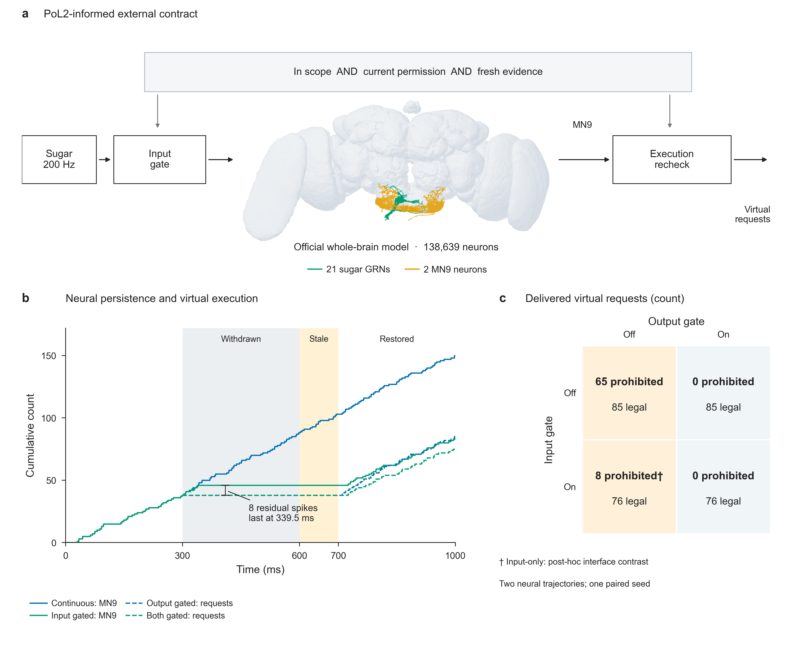

# PoL2 双向安全阀：果蝇全脑模型中的部署位点与失效边界

2026 年 11 月 17 日。研究记录，包含保存结果的探索性、事后分析；AI 辅助核对，尚未完成独立人工审校，非投稿稿。

**研究问题：当授权撤回而神经活动仍在持续时，控制输入是否足够？执行端复核怎样影响未授权请求与合法响应？**本轮将 PoL2 的双向动态安全阀作为规范动机，在官方全脑模型外部比较门的部署位点。当前证据支持一个有限机制结论：本次试验中，停止糖输入后仍有下游请求，执行端复核能约束送达；同时控制输入并未比只控制输出表现出更好的请求结果。



**图｜PoL2 规范动机、部署机制与保存结果。**a：外部契约向输入门和执行端复核提供当前条件；中间的 21 个糖感受神经元与 2 个 MN9 使用真实骨架，灰色为注册脑区参考图谱，颜色仅表示解剖角色。全脑计算仍包含 138,639 个神经元。b：两条配对神经轨迹的 MN9 累计放电，以及按保存轨迹和冻结门规则重建的虚拟请求曲线；重建汇总与原在线运行记录逐项相等。300–600 ms 撤权，600–700 ms 证据过期，700 ms 后恢复有效授权。c：四个接口条件的未授权与合法送达数量。† 仅输入门条件是事后接口对照，原运行未单独记录该条件；全部四个条件只使用两条神经轨迹、一个配对种子，没有误差条。

## PoL2 原文如何进入实验

原文固定为 NaturalDAO 提交 `a7b2e311e19d2b02d7da33ed8d27946673b1f59d`。以下映射由 AI 对该已提交 Git 内容核对，研究者的工程设定单独列明。

| 规范来源 | 在本实验中的作用 | 已测范围与工程设定 |
|---|---|---|
| E1：[5.4.1 双向动态安全阀](https://github.com/naturaldao/NaturalDAO/blob/a7b2e311e19d2b02d7da33ed8d27946673b1f59d/PoL/5.%20AI%E5%92%8C%E4%BA%BA%E7%B1%BB%E6%96%87%E6%98%8E%E7%9A%84%E6%B2%BB%E7%90%86%EF%BC%9A%E4%BB%8E%E6%81%A82%E8%AF%81%E6%98%8E%E5%88%B0%E7%88%B12%E8%AF%81%E6%98%8E.md#L129-L134) | 原文明确要求“对输入输出进行严格的动态审计与拦截”，为比较输入端、输出端和双端部署提供直接动机。 | 原文没有指定本实验的布尔门算法、神经模型或放电阈值。 |
| E2：[2.10 持续同意与撤回](https://github.com/naturaldao/NaturalDAO/blob/a7b2e311e19d2b02d7da33ed8d27946673b1f59d/PoL/2.%20%E7%88%B1%E8%AF%AD.md#L206-L226) | 将持续同意和可撤回边界类比为随时间更新的外部许可。 | 原文讨论人际身体接触；糖刺激许可是研究者的工程类比，不是果蝇具有同意概念。 |
| E3：[决策共识与边界记录](https://github.com/naturaldao/NaturalDAO/blob/a7b2e311e19d2b02d7da33ed8d27946673b1f59d/PoL/4.%20PoL2%E4%B9%8B%E4%BC%A6%E7%90%86%E5%AF%B9%E9%BD%90%E5%8D%8F%E8%AE%AE.md#L73-L78) | 为记录适用范围和当前授权提供规范动机。 | 本次 `scope` 始终为 `simulated_sugar_trial`，没有测试越范围或跨对象事件。 |
| M1：研究者操作化 | 许可通过需要范围匹配、当前许可和新鲜证据同时成立；每次前向计算后复核虚拟输出。 | `fresh` 布尔值、300/600/700 ms 时间表、200 Hz 输入、MN9 放电到虚拟请求的映射，均为工程选择，不是 PoL2 原文算法或定理。 |

## 真实结果与权衡

N1–N3 来自[原 v3 运行记录](../../../PoL-Governance/benchmark/fly_brain/official/results/eon-pol2-20261117-v3/manifest.json)、[保存活动](../../../PoL-Governance/benchmark/fly_brain/official/results/eon-pol2-20261117-v3/activity.npz)及[新增派生核验](../../../PoL-Governance/benchmark/fly_brain/official/analysis/pol2-2x2-20261117/saved_2x2_analysis.json)。表中数量均为本次模拟的虚拟请求计数。

| 输入门 | 输出门 | MN9 生成请求 | 合法送达 | 未授权送达 | 被拦截 |
|---|---|---:|---:|---:|---:|
| 关 | 关 | 150 | 85 | 65 | 0 |
| 关 | 开 | 150 | 85 | 0 | 65 |
| 开 | 关 † | 84 | 76 | 8 | 0 |
| 开 | 开 | 84 | 76 | 0 | 8 |

**N1：停止输入没有立即消除下游活动。**300 ms 停止授权输入后，左右 MN9 各出现 4 次残留放电，最后一次在 339.5 ms，即撤权后 39.5 ms。它是本试次最后一次观测事件的时间，不是所有神经状态的清除时间，也不能解释为权限、目标或伦理记忆。

**N2：执行端复核约束送达，输入门改变神经响应。**仅输出门与双门都达到 0 未授权送达；双门合法送达为 76，低于仅输出门的 85。输入门将禁止期间的 MN9 请求从 65 降为 8，同时改变了合法期间的响应；现有结果没有证明双门更安全或更优，也没有测量能耗或身体任务收益。

**N3：恢复授权后仍有被允许的响应。**700 ms 后，连续输入轨迹合法送达 47 个请求，输入门轨迹合法送达 38 个请求。这些计数不是重新学习或记忆恢复，也不是身体行为或任务完成率。

† 输出门不反馈到本实验的神经动力学，因此移除输出门后的接口请求可以由保存的 MN9 轨迹精确推导。这个事后条件没有增加神经运行、独立样本或在线实验。零未授权送达由门规则构造，采用相同条件的普通规则门也会得到相同结果，不能归因为 PoL2 标签的独有优势。

## 当前研究支持什么，下一步怎样检验

已完成的是 PoL2 启发下的外部治理部署研究：区分持续的神经动力学、当前授权和允许送达的请求。原全脑权重与神经动力学没有改动，尚未训练神经模型理解 PoL2，也未验证完整 PoL2 内化。

下一步应预先固定更多配对种子及延迟事实、未知许可、错误范围等故障条件，同时加入独立的合法任务结果；比较未授权送达、误拦和任务代价。仅输出门已有零未授权送达，新增输入干预需要证明额外收益并报告合法功能损失。若进一步研究 PoL2 内容本身的作用，还需采用规则内容真正不同、来源清楚的策略与对照；同内容门的相等结果不能回答该问题。这些均是待检验设计，本轮没有新增相关实验。

## 证据、复算与审阅状态

- [派生分析脚本](../../../PoL-Governance/benchmark/fly_brain/official/analyze_pol2_saved.py)直接读取保存数据，不导入或调用神经模型；[逐阶段 CSV](../../../PoL-Governance/benchmark/fly_brain/official/analysis/pol2-2x2-20261117/saved_2x2_phases.csv)保留每侧计数。
- [证据索引](../../../PoL-Governance/benchmark/fly_brain/official/analysis/pol2-2x2-20261117/evidence_manifest.json)记录 E1–E3、M1、N1–N3 的来源、版本与核对状态；人工审核仍待完成。
- [绘图代码](../../../PoL-Governance/benchmark/fly_brain/official/plot_pol2_research.py)、[图件来源记录](../figures/pol2-brain-research-20261117.json)、[PDF](../figures/pol2-brain-research-20261117.pdf)、[SVG](../figures/pol2-brain-research-20261117.svg)。原数据中只有 23 个监测神经元的完整时序；其他神经元仅保存整秒累计数，不能据此重建全脑撤权期活动图。

```powershell
& 'D:/Codebase/PoL2-FlyVis-Official/.venv/Scripts/python.exe' 'PoL-Governance/benchmark/fly_brain/official/analyze_pol2_saved.py' --check
& 'D:/Codebase/PoL2-FlyVis-Official/.venv/Scripts/python.exe' 'PoL-Governance/benchmark/fly_brain/official/plot_pol2_research.py'
```

本研究使用 AI 辅助实现、计算核对和写作，尚待独立人工审校。证据整理方法参考 Kassis, T., Agarwal, V., He, Y., Patel, D., & Brueckner, A. M. (2026). [Scientific Agent Skills: A Library of Procedural Knowledge for Research Agents](https://doi.org/10.48550/arXiv.2609.00065)。
