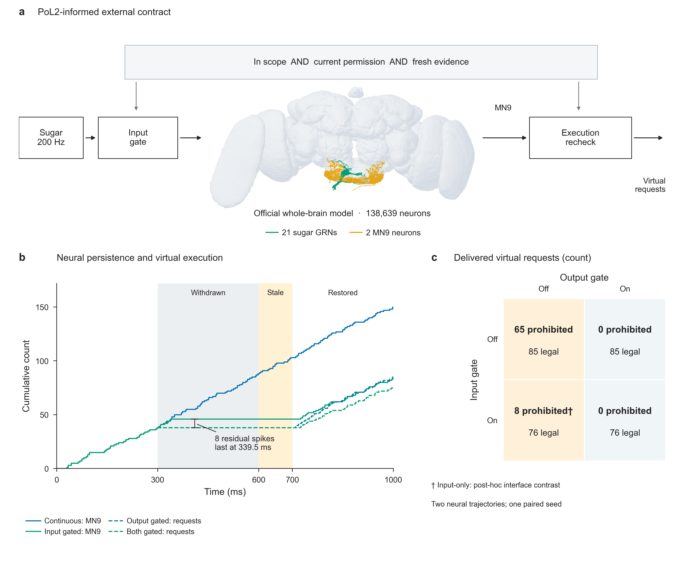

# 果蝇模型图表规范与导出

2026 年 11 月 17 日。涵盖原实验图、真实神经形态图与PoL2研究主图；这是对公开绘图要求的采用，不代表 Nature 审核或录用。

研究主线：[PoL2双向安全阀的部署位点与失效边界](PoL2-Brain-Research.md)。图中把规范动机、输入/输出门的部署和已有全脑结果对应起来；仅输入门条件明确标为事后推导。



解剖配图见[真实神经形态视图与来源](Morphology-View.md)；原先的放电与空间量化图保留用于核对。

## 采用的官方要求

- [Nature research figure guide：版面与导出](https://research-figure-guide.nature.com/figures/building-and-exporting-figure-panels)：双栏宽 183 mm，图高不超过 170 mm；统一 Arial，普通文字 5–7 pt，小写粗体分面字母 8 pt。
- [Nature：最终稿图件](https://www.nature.com/nature/for-authors/final-submission)：最终尺寸下线宽 0.25–1 pt，文字与线条保持可编辑。
- [Nature research figure guide：具体规范](https://research-figure-guide.nature.com/figures/preparing-figures-our-specifications)：标清坐标与单位，采用可辨认的配色，取消背景网格、装饰和重叠标注。RGB 导出；PDF 嵌入 TrueType 字体，不将文字转成轮廓。

共同绘图设置保存在 [figure_style.py](../../PoL-Governance/benchmark/fly_brain/official/figure_style.py)。离散数据采用 Wong 色系，全脑放电率采用 cividis 顺序色标，FlyVis 正负活动采用以零为中心的蓝红发散色标；标注使用黑色文字，深色条形内的计数用白字保证对比度，通过图例、符号和引线区分数据。统计数量、来源和实验限制放在[结果报告的图注](Official-Models-Results-20261117.md)，图内保留必要标签。

## 文件

| 图 | PNG 预览 | PDF | SVG |
|---|---|---|---|
| PoL2研究主图 | [PNG](figures/pol2-brain-research-20261117.png) | [PDF](figures/pol2-brain-research-20261117.pdf) | [SVG](figures/pol2-brain-research-20261117.svg) |
| 神经形态主图 | [PNG](figures/eon-brain-morphology-20261117.png) | [PDF](figures/eon-brain-morphology-20261117.pdf) | [SVG](figures/eon-brain-morphology-20261117.svg) |
| 中央 T4/T5 响应 | [PNG](figures/flyvis-center-responses-20261117.png) | [PDF](figures/flyvis-center-responses-20261117.pdf) | [SVG](figures/flyvis-center-responses-20261117.svg) |
| T4c 空间活动 | [PNG](figures/flyvis-spatial-activity-20261117.png) | [PDF](figures/flyvis-spatial-activity-20261117.pdf) | [SVG](figures/flyvis-spatial-activity-20261117.svg) |
| 完整全脑位置与放电 | [PNG](figures/eon-whole-brain-20261117.png) | [PDF](figures/eon-whole-brain-20261117.pdf) | [SVG](figures/eon-whole-brain-20261117.svg) |
| PoL2 授权与虚拟输出 | [PNG](figures/eon-pol2-20261117.png) | [PDF](figures/eon-pol2-20261117.pdf) | [SVG](figures/eon-pol2-20261117.svg) |

PNG 为最终物理尺寸下直接生成的 600 dpi 预览。PDF 与 SVG 保留文字、坐标和线条；全脑大量空间点及放电点以独立图像层嵌入，避免数十万矢量元素影响编辑，文字没有随点层栅格化。SVG 使用系统 Arial，PDF 内嵌字体。

[导出核验记录](figures/export-quality-20261117.json)列出每幅图的物理尺寸、像素、字体、可编辑文字数量与文件 SHA-256。所有 PNG 及由 PDF 重新渲染的预览均实际打开检查；原始实验数据与运行记录校验值保持一致。

## 从保存的数据重绘

以下脚本不调用神经模型、不需要 GPU，也不重新选择模型或刺激：

```powershell
$figures = 'PoL-Governance/benchmark/fly_brain/official'
& 'D:/Codebase/PoL2-FlyVis-Official/.venv/Scripts/python.exe' "$figures/plot_flyvis_saved.py"
& 'D:/Codebase/PoL2-FlyVis-Official/.venv/Scripts/python.exe' "$figures/plot_eon_pol2.py"
```

全脑空间图还需已有的官方神经元清单和坐标输入：

```powershell
& 'D:/Codebase/PoL2-FlyVis-Official/.venv/Scripts/python.exe' "$figures/render_whole_brain.py" --eon-root 'D:/Codebase/PoL2-FlyVis-Official/upstream/fly-brain' --coordinates 'D:/Codebase/PoL2-FlyVis-Official/downloads/flywire-v783-coordinates.csv.gz' --spikes 'D:/Codebase/PoL2-FlyVis-Official/upstream/fly-brain/data/results/pol2_sugar_function_20261117/round_01/pytorch_t1.0s_n1.parquet' --output 'Research/Brain/figures/eon-whole-brain-20261117.png'
```

绘图依赖为原实验环境已有的 NumPy、pandas、pyarrow、Matplotlib 与 Pillow。Windows 使用已安装的 Arial。移动边缘的原始模拟脚本及其哈希保持原样，新脚本只读取保存的 NPZ 与指标；全脑坐标保持首个社区锚点策略，不改变位置或创造形态。原版图可从 [55c6a4c 版本](https://github.com/naturaldao/NaturalDAO-2nd/tree/55c6a4c/Research/Brain/figures)查看。
