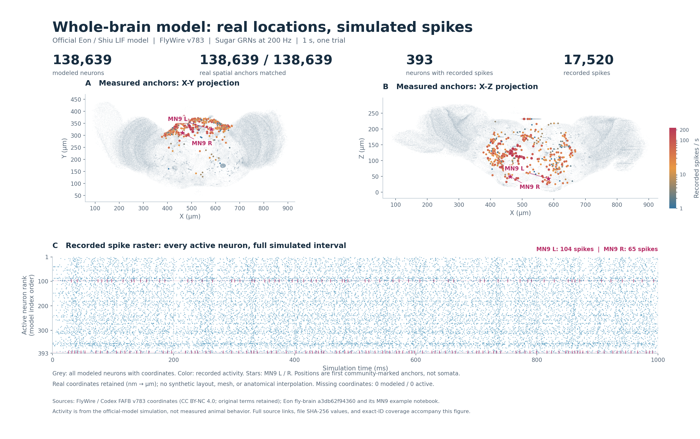

# 官方果蝇模型运行与 PoL2 外部适配

2026 年 11 月 17 日

**官方权重已加载且真实运行。**本轮运行两种官方模型：FlyVis 加载公开学习检查点；Eon 加载官方全脑连接权重及固定 LIF 参数，后者没有训练检查点。两者均使用完整模型规模，区别于此前的 65 类型聚合代理。

| 模型 | 实际规模 | 权重与运行核验 |
|---|---|---|
| FlyVis，固定版本 `0a69fa2` | 45,669 个神经元、1,513,231 条边 | 官方 `flow/0000/000` 检查点，5 组状态张量逐项精确相等 |
| Eon，固定版本 `a3db62f` | 138,639 个神经元、15,091,983 条边 | 从原始连接表独立构造的稀疏矩阵与官方缓存逐项相等 |

## FlyVis 完整空间模型通过加载与移动边缘检查

使用官方 extent-15 空间网络，ZIP 与检查点均记录校验值。直接运行 20 帧，输出形状为 `1×20×45669`，数值有限且发生变化；没有调用缓存响应。随后按官方范式新模拟 24 个移动边缘刺激，合计 **50 次前向计算、16,660 个积分帧**，包含预适应及加载检查。[加载与运行记录](../../PoL-Governance/benchmark/fly_brain/official/results/flyvis-moving-edge-20261117/manifest.json)

预先指定的 T4c ON 对比成立：90°峰值 **1.032089**，270°为 **0.024330**。但完整调谐计算的偏好方向为 **56.236°**，不能称准确恢复 90°；T4d ON 方向选择指数仅 **0.098756**，弱选择性结果完整保留。本轮复现加载、计算与该功能范式，没有重训或验证全部生物学功能。[全部指标](../../PoL-Governance/benchmark/fly_brain/official/results/flyvis-moving-edge-20261117/metrics.json)

## Eon 全脑模型产生真实模拟放电

原官方 CUDA 实现中，0.1 秒运行记录 **1,646 次放电、343 个活跃神经元**；1 秒糖刺激运行记录 **17,520 次放电、393 个活跃神经元**，MN9 左／右分别为 **104／65 次**。这些是模拟神经放电，没有身体或喙运动。[0.1 秒记录](../../PoL-Governance/benchmark/fly_brain/official/results/eon-original-20261117/smoke-0.1s.parquet) · [1 秒记录](../../PoL-Governance/benchmark/fly_brain/official/results/eon-original-20261117/function-1s.parquet)

图中空间来自 FlyWire v783 社区标记锚点，按 root ID 匹配全部 138,639 个模型神经元，覆盖率 100%；它不是胞体重建或神经元表面网格。[坐标来源与绘图记录](figures/eon-whole-brain-20261117.json)

## PoL2 适配改变输入与模拟执行接口

新增适配器把 MN9 放电映射为人工执行请求。v3 在每次完整全脑前向计算后，立即按权限与证据时效检查虚拟输出，合计 **20,000 次在线检查**；这不是物理执行器。配对神经轨迹使用同一随机种子，干预前状态严格相等，未修改官方连接权重或神经动力学。[v3 完整记录](../../PoL-Governance/benchmark/fly_brain/official/results/eon-pol2-20261117-v3/manifest.json)

持续糖输入下，MN9 左／右为 **90／60 次**，0.3–0.7 秒权限撤回或证据过期期间有 **65 个未获许可请求**；输出门将其全部阻止，合法接受 85 个。输入也在该期间停止时，左右为 **53／31 次**，撤权后仍残留 **8 次放电**，同样由输出门拦住；0.7 秒恢复授权与输入后接受 **38 个请求**，全程合法接受 76 个。

这是一个种子的外部门控验证：零未授权接受由接口规则实现；输入停止不等于神经状态立即清除，也没有训练或内化 PoL2。输出单独门控共享持续输入的神经轨迹，不是额外独立神经重复。

首次 Windows [HDF5 文件关闭失败](../../PoL-Governance/benchmark/fly_brain/official/results/flyvis-smoke-20261117/failure.json)、适配器由 `inference_mode` 改用官方 `no_grad` 的[失败记录](../../PoL-Governance/benchmark/fly_brain/official/results/eon-pol2-20261117/failure.json)均保留；v2 输出原为放电序列后处理，v3 改为逐步在线模拟门控，主结果只引用 v3。复现与原始来源见[运行说明](../../PoL-Governance/benchmark/fly_brain/official/README.md)。FlyVis 保持 MIT、Eon 保持 GPL-2.0-or-later，FlyWire 坐标保持 CC BY-NC 4.0；第一方 Proof of Love2 声明不替代第三方许可。实现与报告使用 AI 辅助，未声称独立人工专家审核。
