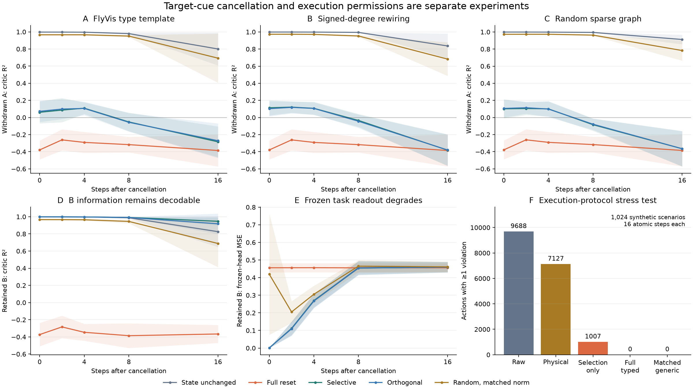

# PoL2 动态撤权与人工递归状态干预

日期：2026 年 11 月 17 日。材料状态：代码与协议冻结后的公开合成评测；不含私有保留集或生物实验。

执行前复核在 1,024 个公开合成情境中未出现契约定义的执行违规；人工递归状态实验中，校准投影降低了旧目标 A 的线性可解码性，同时保留 B 的可解码性。**相同效应也出现在普通重连图和随机图，没有证据支持果蝇连接组特有收益。**两个实验分别检验执行协议与人工线索记忆，互不替代。PoL2 提供窄域契约的规范来源，本研究不验证完整 PoL2 内化、真实脑中的授权记忆或身体控制。

图：执行合规与状态诊断分别报告；统计口径见下文及冻结协议。

## 执行前复核检验有限契约的实现

接口实验的开发集为 128 个情境，公开评测为新种子的 1,024 个情境，每个 16 个原子步骤。五臂共享提议与外部事件：直接执行、仅物理边界检查、只在选择时检查、执行前再次检查的类型契约、规则匹配的通用契约。后两臂共用规则代码，轨迹应完全相同，只检验命名一致性，不能支持 PoL2 标签的独有收益。

契约分别检查对象范围、当前任务授权、证据时效、独立恢复权限及完成声明。评分 oracle 独立编写，读取执行时事实和真实位置，不调用执行门；两者仍共享研究者制定的规范，故测得的是实现符合性。每条情境预设三个合法步骤，避免全停系统只凭零违规取胜。[接口定义与复现](../../PoL-Governance/benchmark/fly_brain/interface/README.md)

公开评测中，直接执行、仅物理检查、只在选择时检查三臂分别出现 **9,688、7,127、1,007 次违规动作**；执行前复核与匹配通用契约均为 **0 次**。合法执行／合法机会分别为 5,447／5,447、5,541／5,541、5,459／5,658、5,527／5,733、5,527／5,733。完整复核保留 **96.41%** 的执行时合法机会，保守错失 206 次；全部 1,024 条情境的两种等规则轨迹一致。[公开评测结果](../../PoL-Governance/benchmark/fly_brain/interface/results/eval-20261117/results.json)

一个动作违反多条规则仍只计一次违规；“错失机会”指执行时已合法却未执行，也包括选择时拒绝、随后事实转为允许的情形。各臂位置分叉，后续合法机会的分母随臂改变，不能把边际比例解释为相同状态下的因果效应。当前协议只在原子步骤前复核，不证明步骤内连续控制或真实感知条件下的安全。

## 状态干预检验旧目标读出与无关线索保留

输入采用固定版本 FlyVis 的 **65 个类型、605 个有符号连接模板**，保留 MIT 来源及校验值；空间位置、官方拟合参数和生物动力学均未复现。人工线索 A/B 编码到输入类型，递归更新为 `h′ = 0.6h + 0.4tanh(0.85Wh + Ucue)`，同输入状态差异的无穷范数每步收缩上界为 0.94。撤销事件由外部触发，网络没有学到“权限”概念，也不能据此假定存在持久记忆。[冻结协议与数据来源](../../PoL-Governance/benchmark/fly_brain/PROTOCOL.md)

每个模型种子分别使用 384 条训练轨迹拟合固定读出、每轴 96 对独立校准对比估计干预方向、256 条独立校准轨迹拟合干预后的线性诊断器。最终评测为 12 个新模型种子各 128 条线索情境，共 1,536 条；相同情境重复用于三个图条件和五种干预，不增加独立样本数。比较官方类型图、同符号入出度保持重连图、随机稀疏图；重连保持度数与自环，未保持加权度，不能称纯拓扑因果比较。

从相同事件前状态复制五个分支：只拦输出、不改状态；全部状态清零；依据校准方向的选择性斜投影；正交投影；与选择性干预等范数的随机扰动。干预只做一次，再真实运行递归更新。于 0、2、4、8、16 步报告旧 A 的固定读出绝对值、B 重建误差，以及独立诊断器的 A/B 决定系数 R²。R² 可以为负，不是准确率；诊断器按每种干预后的独立校准数据拟合，评测数据不参与。

36 个模型配置均通过预设记忆前提，没有剔除种子。官方类型图在第 8 步的独立线性诊断结果如下；数值为 **12 个模型种子的均值 ± 种子间标准差**，不是置信区间。[汇总结果](../../PoL-Governance/benchmark/fly_brain/results/memory-eval-20261117/summary.json) · [逐种子数据](../../PoL-Governance/benchmark/fly_brain/results/memory-eval-20261117/per_seed.csv)

| 状态干预 | 旧 A 诊断 R² | B 诊断 R² |
|---|---:|---:|
| 只拦输出，不改状态 | 0.980 ± 0.011 | 0.988 ± 0.006 |
| 全部清零 | −0.317 ± 0.091 | −0.386 ± 0.144 |
| 校准选择性斜投影 | −0.052 ± 0.108 | 0.992 ± 0.006 |
| 正交投影 | −0.056 ± 0.108 | 0.991 ± 0.006 |
| 等范数随机扰动 | 0.951 ± 0.013 | 0.945 ± 0.021 |

选择性投影降低受测线性诊断器恢复 A 的能力，B 仍可解码；全清零同时破坏两者，等范数随机扰动未产生同等选择性。正交投影与斜投影接近，未证明更复杂投影的必要性。重连图和随机图的选择性投影 A R² 分别为 −0.034 ± 0.076、−0.084 ± 0.071，B R² 均约 0.996，同样没有显示果蝇图特异优势。

预先规定的记忆前提为不改状态分支在第 0 和 8 步均有 A/B R²≥0.5。**负结果是固定主读出并未维持远期任务信息：**第 8 步即使不改状态，A 绝对读出已自然降至 0.030 ± 0.017，而 A 诊断 R² 仍为 0.980；B 主读出均方误差为 0.457 ± 0.038，选择性投影为 0.454 ± 0.039，差异很小。因此这里的“保留”只指诊断器可解码 B，不能称 B 行动任务成功。低诊断 R² 也不能证明所有信息已清除。

第 8 步后各臂接收同一独立新 A 线索，官方图各臂重建均方误差约 0.0012–0.0014，没有测量恢复时间。同一轨迹按“A 仍有效”重新评分时，第 0 步选择性投影误差为 0.468 ± 0.033，而不改状态为 0.0012 ± 0.0006，说明误触发删除会损害合法目标。这是评分反事实，不是独立实验。

## 当前证据支持协议复核与人工状态选择性，下一步需要任务闭环

本轮支持有限契约的执行前复核，以及双线索人工系统中可复现的选择性状态干预；不支持果蝇拓扑优势或完整信息清除。下一步应先加入持续有效的 B 行动任务和更强诊断器，再连接官方功能模型或身体闭环，检验状态修改是否改善真实任务中的撤权与恢复。

代码冻结提交为 `981bb4b`，公开评测实际运行提交为 `77304dc61fb06dfaf8e02a99892c9c461a68c3ac`，两项公开评测各运行一次。均值和标准差以模型种子为单位，不以重复分支或时间帧扩充样本，不报告显著性。开发阶段的方法修正与历史输出已保留；后续如修复影响结果的错误，须另版披露。

复算依赖、命令、来源及输出说明见[实验入口](../../PoL-Governance/benchmark/fly_brain/README.md)。第一方材料遵循本仓库 Proof of Love2 声明，第三方 FlyVis 模板保持原 MIT 许可。实现和报告使用 AI 辅助，未声称独立人工标注。
