# 小神经系统与无神经元细胞如何形成动作决策

文献截至 2026 年 11 月 17 日，正文修订于 11 月 18 日。

## 摘要

本文以转向、前进时间和动作切换概率为观察指标，比较果蝇、线虫、蚂蚁和单细胞生物如何利用近期刺激或既往经历调节运动。同一刺激可以引出不同动作。解释这种差异，需要知道刺激到来时，动物或细胞处于什么状态。

在果蝇的定向任务中，神经元群体分别携带当前朝向和目标朝向的信息，两者的偏差与转向有关。线虫受刺激前的网络状态会影响随后作出反应的概率。沙漠蚁返巢时综合步态、天光和视觉记忆；蚁群选巢时，个体间的招募与相遇频率又会影响群体选择。[果蝇导航](REFERENCES.md#F05) · [线虫状态依赖](REFERENCES.md#W03) · [蚂蚁导航与选巢](REFERENCES.md#A02)

单细胞也能保留过去刺激的影响。大肠杆菌的运动随近期吸引物浓度变化而改变，草履虫通过膜电活动与纤毛运动调节前进和后退，多头绒泡菌的管径变化可以保留营养位置的信息。这些结果允许比较同一类控制问题在不同生物中的实现方式。[细菌趋化](REFERENCES.md#C02) · [草履虫回避](REFERENCES.md#C07) · [绒泡菌管网](REFERENCES.md#C12)

作为跨物种参照，两只乌鸦在随机点运动任务中表现出与证据积累相符的神经活动。该研究提供了感觉证据、神经活动与作答时刻的对应关系。样本限于两只受训鸟，跨物种反应时还受任务和动作要求影响。[乌鸦视觉选择实验](REFERENCES.md#N06)

正文附 9 幅论文原图、1 幅开放数据复绘和 3 幅机制示意图。各图的原始编号、署名和许可见[图源索引](FIGURES.md)。

## 1. 研究对象与动作决策的定义

### 1.1 系统规模的计量口径

蚂蚁和果蝇有神经系统；单细胞生物没有神经元间构成的神经网络。细胞内部却存在受体、信号蛋白、膜电、离子、细胞骨架与形态变化。这些变量可以相互作用，也可以携带过去输入的影响。因此，细胞应列为“无神经元”，而不是“只有一个神经元”。[C04](REFERENCES.md#C04)、[C07](REFERENCES.md#C07)、[C12](REFERENCES.md#C12)

比较物种时，除了神经元数量，还要说明感觉输入、可选动作、保留信息的时长和任务环境。下表列出各项研究实际计数的对象。

| 对象与数据 | 可以使用的规模 | 必须保留的口径 | 来源 |
|---|---:|---|---|
| 秀丽隐杆线虫，成年雌雄同体 | 302个神经元 | 全动物神经系统；成年雄虫为385，不能混用 | [W01](REFERENCES.md#W01) |
| 黑腹果蝇，首龄幼虫脑，2023 | 3,016个神经元；约548,000个突触位点 | 包括480个输入神经元与2,536个已分化脑神经元；不是成虫，也不是全部中枢 | [F02](REFERENCES.md#F02) |
| 黑腹果蝇，成年雌性脑，2024 | 139,255个神经元；5,450万个化学突触链接 | 包括中央脑与两侧视叶，不含完整腹神经索 | [F01](REFERENCES.md#F01) |
| 黑腹果蝇，BANC，2026 | 155,916个已校对或粗校对神经元 | 雌性脑与腹神经索的联合重建；缺失部分区域，校对完整度不同，不能当精确全身总数 | [N01](REFERENCES.md#N01) |
| 黑腹果蝇，MaleCNS，2026 | 166,700个神经元，含感觉轴突；1.242亿突触链接 | 雄性脑与腹神经索；神经元对之间约2,560万条图边，与突触数不同 | [N02](REFERENCES.md#N02) |
| 蚂蚁，Novomessor spp.的特定研究 | 不同方法约7万与9万**总脑细胞** | 含胶质细胞，不能改写成神经元；也不能推广为所有蚂蚁 | [A01](REFERENCES.md#A01) |
| 大肠杆菌、草履虫、喇叭虫 | 无神经元 | 分子或膜电网络不按神经元数计量 | [C01](REFERENCES.md#C01)、[C07](REFERENCES.md#C07)、[C08](REFERENCES.md#C08) |
| 多头绒泡菌营养体 | 无神经元；多核巨大单细胞 | 单细胞并不意味着微小或单核，不能与细菌按“一个细胞”直接比较复杂度 | [C11–C14](REFERENCES.md#C11) |

2024与2026的果蝇数字来自不同标本、性别、覆盖范围和重建版本，不能用差值推导性别造成多少神经元增长。昆虫一个突触前结构可连接多个突触后对象；突触链接、突触前结构、神经元对图边，也不能互换。[F01](REFERENCES.md#F01)、[N01](REFERENCES.md#N01)、[N02](REFERENCES.md#N02)

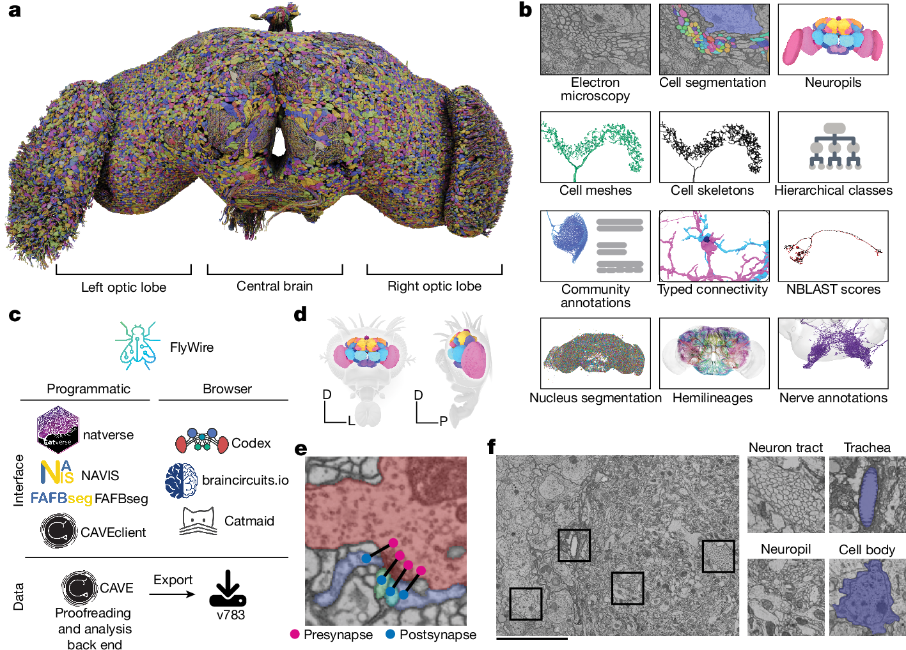

**学术原图 O01｜连接组测到的是什么。** a为中央脑和两侧视叶，b–d为重建与分析资源，e说明一个突触前结构可连接多个突触后对象，f为电镜结构实例。它是成年雌性脑的结构资源，不包含完整腹神经索，也没有给出全部动态生理参数。出处：Dorkenwald等（2024），Fig.1，[F01](REFERENCES.md#F01)；CC BY 4.0，原图未改动。[完整图源与许可](FIGURES.md#O01)

下文的果蝇研究均以黑腹果蝇为例，该物种具有可相互参照的连接组、生理记录和干预实验。

### 1.2 动作决策的观测指标

本报告采用一个可测量、较少拟人化的定义：**当前输入与内部状态共同决定动作的方向、强度、持续时间，或从一种动作切换到另一种动作的概率。** 这个定义允许随机选择，也允许连续调节；不预设细胞或动物具有主观体验。

应分开四层问题：

1. **表征：**系统保存了什么，如当前朝向或近期刺激背景。
2. **选择：**这些状态怎样偏置左转、右转、接近、回避或等待。
3. **执行：**肌肉、纤毛或形变怎样产生运动。
4. **学习：**经历怎样改变之后的映射。

观察到动作，未必已经找出选择机制；找到节律发生器，也未必解释了何时开始走、朝哪里走。

## 2. 感觉输入、内部状态与运动反馈

下图是跨研究的功能综合，不表示不同物种使用同一解剖结构。

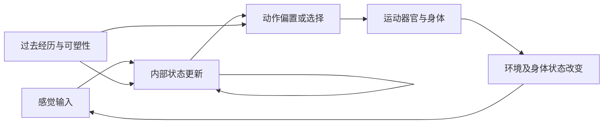

图1．闭环允许系统把计算分散到神经或分子动力学、身体与环境。内部状态的自连接表示历史依赖，不要求一定有神经突触。依据方向保持、线虫状态反馈、细菌适应和黏菌结构记忆综合绘制。[F03](REFERENCES.md#F03)、[W03](REFERENCES.md#W03)、[C04](REFERENCES.md#C04)、[C12](REFERENCES.md#C12)

可以用以下一般状态空间表达式帮助理解；它是本报告的分析记号，不是任何一种动物已经被完整识别的真实方程：

$$
x_{t+1}=F(x_t,s_t,b_t;\theta),\qquad
a_t\sim\pi(a\mid x_t,s_t,b_t).
$$

其中，$s_t$ 是感觉输入，$x_t$ 是神经或分子状态，$b_t$ 是身体状态，$\theta$ 表示相对缓慢的结构或可塑性参数。动作改变身体与下一次输入。学习可以改变 $\theta$；短期保持也可以只改变 $x_t$，两者不是同一件事。

线虫实验给出了历史依赖的例子。研究者改变刺激到来之前的网络状态，随后测得神经反应和行为反应的可靠性也发生变化。[W03](REFERENCES.md#W03)

## 3. 果蝇的定向、选择与运动执行

### 3.1 神经元群体如何保持朝向信息

Seelig与Jayaraman在受控视觉环境中发现，果蝇相关神经元群体的活动峰随朝向移动；有地标时受视觉约束，黑暗中仍能根据自身运动更新。Kim等随后用光干预改变方向活动表征，发现回路能够维持被设定的状态，支持环吸引子机制。[F03](REFERENCES.md#F03)、[F04](REFERENCES.md#F04)

活动峰沿环形回路移动，其位置随果蝇朝向变化。地标消失后，这一表征仍可随自身转动而更新，因而可以用来研究方向信息如何在两次感觉输入之间保持。

### 3.2 从朝向偏差到转向

2024年Mussells Pires等给出更接近动作选择的证据：EPG群体表示当前朝向，FC2活动与目标朝向相关；PFL3结合两类信息，输出与身体左右转向有关的信号。局部刺激FC2可以引导果蝇按实验设定的方向前行，PFL3干预的结果与模型预测相符。[F05](REFERENCES.md#F05)

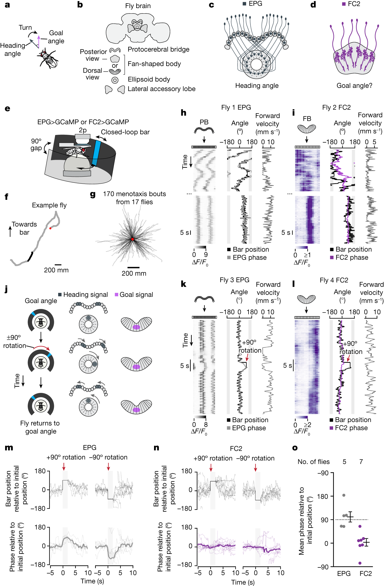

**学术原图 O02｜当前朝向与目标相关状态可分开表示。** 原图h–i比较两类群体活动；j–o中视觉参照突然旋转后，EPG活动峰随之更新，FC2活动峰相对稳定。此图结合行为与成像，显示信息的可分离性；不能单凭这幅图证明FC2完成全部目标选择。出处：Mussells Pires等（2024），Fig.1，[F05](REFERENCES.md#F05)；CC BY 4.0，原图未改动。[完整图源与许可](FIGURES.md#O02)

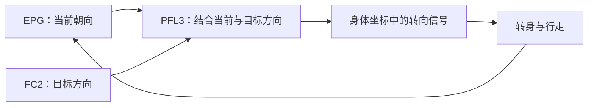

图2．该图概括具体导航任务中的已研究通路；省略中间及平行回路，不代表所有动作都由这一比较器决定。[F05](REFERENCES.md#F05)

在这一导航任务中，当前朝向与目标朝向的偏差可以解释果蝇向哪一侧转动。实验中的“目标”指行为所维持的方向。

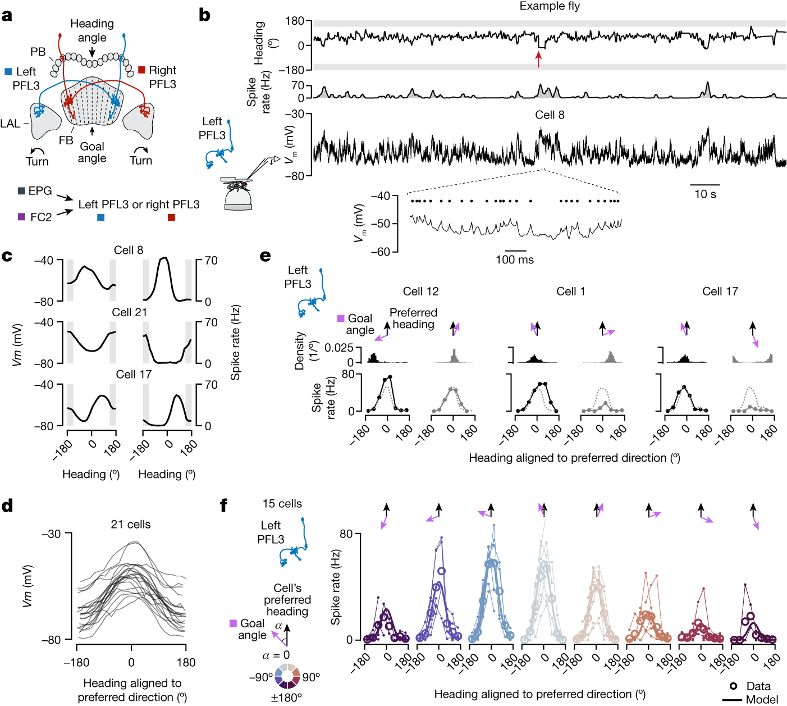

**学术原图 O03｜从表征走向输出的生理环节。** b显示行走果蝇的膜电和放电记录；c–d为朝向调谐；e–f显示目标角度不同时，给定朝向下的放电率也会改变。这里同时有单细胞数据、群体汇总和模型拟合，不能把拟合线全部当作新测量。出处：Mussells Pires等（2024），Fig.3，[F05](REFERENCES.md#F05)；CC BY 4.0，原图未改动。[完整图源与许可](FIGURES.md#O03)

### 3.3 气味经验与接近、回避行为

蘑菇体中，Kenyon细胞提供稀疏感觉表示，输出神经元群体影响接近与回避。Aso等的光激活实验支持输出平衡对行为偏向的作用；Hige等进一步发现，气味与特定多巴胺活动配对，可以产生气味特异、区室受限且依赖时间顺序的突触改变。[F06](REFERENCES.md#F06)、[F07](REFERENCES.md#F07)

再次遇到同一种气味时，果蝇的接近或回避倾向会随先前经历而改变。蘑菇体输出反映了这种行为偏向，具体的肌肉活动仍取决于下游运动回路。

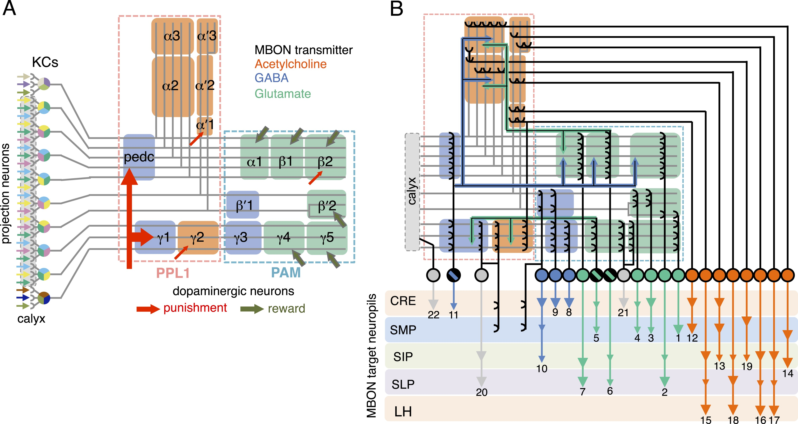

**学术原图 O04｜记忆读出的线路基础。** A展示Kenyon细胞、强化相关通路与区室，B展示不同MBON及其投射。图中的区室与递质类别帮助理解学习如何改变局部读出；这是一幅综合线路图，接近与回避的因果效应还需结合原文行为实验。出处：Aso等（2014），Fig.1，[F06](REFERENCES.md#F06)；CC BY 4.0，原图未改动。[完整图源与许可](FIGURES.md#O04)

### 3.4 气味判别中的时间积分

气味判别困难时，果蝇往往反应更慢、准确率更低，行为能由证据积累模型描述。单靠这样的速度—准确率关系，还不能唯一确认神经实现。[F08](REFERENCES.md#F08)

后续研究把问题推进到生理层面：在该气味判别任务中，αβ核心Kenyon细胞亚群的树突亚阈膜电位能够对感觉输入作时间积分；改变相关电流会改变放电潜伏期和判别时间。2023年的短暂去极化干预还能够加快具体气味判别，伴随较小的准确率代价，支持积累过程对动作承诺时间的贡献。[E01](REFERENCES.md#E01)、[E02](REFERENCES.md#E02)

树突膜电位的变化为时间积分提供了细胞层面的解释。该亚群在完整回路中所起的作用，还需与其他细胞的贡献区分。关于 FoxP 在特定成年 Kenyon 细胞中的表达定位，现有研究仍有分歧。[E03](REFERENCES.md#E03)

### 3.5 步行的启动与节律

2026年10月的Pugliese等研究，在连接组约束的仿真中筛出由两个兴奋性、一个抑制性中间神经元构成的节律核；相关结构在多个连接组和腿部区域中得到比较。研究还对下降通路驱动的腿部节律作了实验验证。[N03](REFERENCES.md#N03)

应区分三层结论：

| 层次 | 这项研究支持什么 | 不能推出什么 |
|---|---|---|
| 仿真内核 | 特定简化回路在模型中对节律具有必要性与充分性 | 活体中三个细胞已被逐一证实为全部行走所必需且充分 |
| 通路实验 | DNg100、DNb08相关预测得到部分行为验证 | 所有模型内部机制均已验证 |
| 完整行走 | 节律生成可以由小回路承担 | 三个细胞即可实现导航、平衡、六足协调与全部选择 |

### 3.6 脑与腹神经索之间的反馈通路

BANC把脑与腹神经索连接起来。其结构分析发现，效应神经元通常受到同一身体部位感觉输入的较强影响，局部反馈单元之间再通过上行、下降和其他长程连接协调。作者据此提出，中央复合体与蘑菇体对部分行为起监督作用，而不是所有动作必经的唯一中央控制器。[N01](REFERENCES.md#N01)

这是基于大规模解剖与影响模型的证据，不能改写为已直接测得每条连接的因果作用。该影响指标采用简化线性动力学，连接权重按非负值处理；它适合提出网络组织假说，不等价于含抑制、调质和身体反馈的完整生理仿真。联合重建也仍有区域缺失及校对完整度限制。[N01](REFERENCES.md#N01)

MaleCNS则提供雄性脑与腹神经索的另一份大规模资源。它推进了性别间线路比较，仍然是一张结构图；作者明确保留了功能实验验证的必要性。[N02](REFERENCES.md#N02)

## 4. 线虫运动与刺激前的网络状态

成年雌雄同体线虫的302个神经元是一个清楚的规模参照，但不能据此想象成每个神经元各对应一个动作。Kato等发现，分布式群体活动形成可对应运动命令序列的低维轨迹；Gordus等表明，同样的气味输入可以因先前网络状态不同而产生不同的响应概率。[W01](REFERENCES.md#W01)、[W02](REFERENCES.md#W02)、[W03](REFERENCES.md#W03)

自由运动条件下的脑广域记录发现，部分细胞同时编码多种行为，当前活动也保留了近期动作的影响。神经活动与行为的对应关系随动物状态而变化。[W04](REFERENCES.md#W04)

证据边界同样重要：2015年Kato研究的主要脑广域成像在固定动物中完成，每只检测的是部分神经元，再通过代表细胞的自由运动记录建立行为映射；不能说当时已经同时记录自由运动线虫的全部302个神经元。低维轨迹描述和行为编码，也不自动证明少数状态变量已对全部动作因果充分。[W02](REFERENCES.md#W02)

## 5. 蚂蚁个体的返巢导航

### 5.1 路径积分中的距离与方向

对已研究的沙漠蚁而言，返巢可利用距离与方向相关的信息。Wittlinger等改变Cataglyphis fortis的步幅后，返巢距离判断出现系统性偏差；结果支持与步态、自运动有关的距离积分，不表示蚂蚁在字面数步。[A02](REFERENCES.md#A02)

Wehner与Müller对同种蚂蚁的太阳与偏振天光操控，支持天光罗盘的作用；在他们的实验条件中，偏振天光并非只在太阳不可见时才使用的备用线索。[A03](REFERENCES.md#A03)

一种有帮助的计算表达是：动物持续更新“相对巢穴的位移向量”，返程时按其反方向移动。这是对路径积分的功能说明，不是已经定位全部蚂蚁神经回路的真实代码。积分会积累误差，视觉等信息则提供额外约束；不同蚁种不能一概而论。

### 5.2 视觉记忆与转向

在Formica rufa中干预蘑菇体，会损害学到的视觉导航，但大型视觉线索引起的某些先天趋向仍保留。Myrmecia midas自然场景返巢研究也发现，蘑菇体垂直叶干预损害定向。[A05](REFERENCES.md#A05)、[A06](REFERENCES.md#A06)

这组证据把学习相关导航与部分基础视觉行为分开：视觉输入不只触发一个固定动作，记忆会改变它的读出。蘑菇体启发的稀疏编码模型也展示了路线记忆的计算可行性，但模型中能存储多少场景，不能改写成已经在活蚂蚁脑里数出多少张照片。[A07](REFERENCES.md#A07)

2026年Wystrach等进一步在Cataglyphis velox与Myrmecia croslandi中研究侧向视觉记忆。行为结果与模型支持：熟悉场景可以先提供目标在左侧或右侧的信息，再结合罗盘参照更新目标方向。这与果蝇当前方向—目标方向比较的研究形成可讨论的联系。[A08](REFERENCES.md#A08)、[F05](REFERENCES.md#F05)

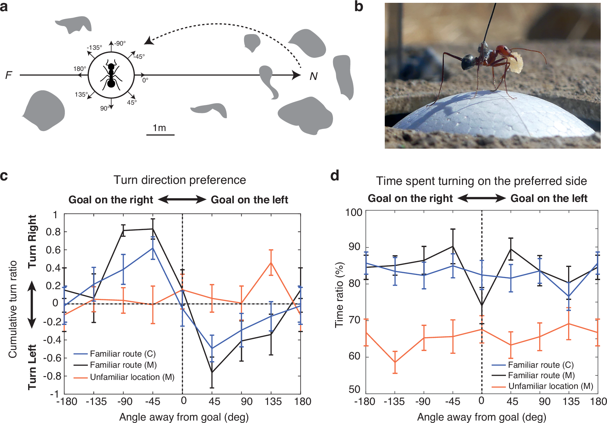

**学术原图 O06｜蚂蚁如何从场景中取得左右信息。** a–b为情境与实拍，c–d分别为不同起始朝向下的转向偏好，以及在偏好侧转向的时间占比；熟悉路线和陌生地点对照保留在原图。这里测量的是行为，不是蚂蚁的神经活动。照片署名Antoine Wystrach。出处：Wystrach等（2026），Fig.1，[A08](REFERENCES.md#A08)；CC BY 4.0，原图未改动。[完整图源与许可](FIGURES.md#O06)

但两者的证据强度不同：蚂蚁研究中的完整蘑菇体—中央复合体信号定位仍含模型假设和跨物种推断，不能写成已在蚂蚁中逐神经元验证了果蝇同样的线路。

### 5.3 导航线索冲突时的权重调整

在返巢向量与视觉记忆冲突时，Cataglyphis velox会改变线索权重；2015年研究发现，最优整合模型能很好描述某些结果。但解耦变量的试验还支持一种较简单解释：蚂蚁可能把返巢向量长度用作可靠性代理，而非逐次显式计算不确定性。[A04](REFERENCES.md#A04)

区分两种解释的关键，在于让返巢向量的长度与方向线索的可靠性分别变化，再观察蚂蚁依赖哪一条线索。

## 6. 蚁群选巢与集体撤离

Pratt等对Temnothorax albipennis（原文旧名Leptothorax albipennis）的研究显示：招募者先通过串联带路增加评估者，当新巢中的支持程度达到阈值后，再切换到较快的搬运。少数个体直接比较候选地点，也可以通过相互作用产生较好的群体结果。[A09](REFERENCES.md#A09)

2005年的后续实验更具体：阻断触碰或改变巢的面积，会改变招募方式切换，支持相遇频率作为群体支持程度的代理。个体不需要逐一准确数人头，群体却能产生阈值行为。[A10](REFERENCES.md#A10)

2022年Gal与Kronauer比较Ooceraea biroi的不同群体规模，发现较大群体的协调撤离温度阈值更高。兴奋与抑制相互作用模型能够解释这种规模依赖，但具体接触、化学信号及其作用仍需进一步拆解。[A11](REFERENCES.md#A11)

| 层级 | 状态主要在哪里 | 动作或结果是什么 |
|---|---|---|
| 单只蚂蚁 | 个体神经活动、身体状态、学到的场景 | 转向、行走、招募或搬运 |
| 蚁群 | 个体状态分布、相遇与招募关系、巢中密度 | 形成集体迁移或选巢结果 |

个体实验以单只蚂蚁的转向、招募或搬运为观测对象，群体实验则记录整群何时迁移、最终选择哪个巢址。解释集体选择时，必须同时考虑个体反应和个体间接触。

## 7. 没有神经元的细胞怎样选择动作

### 7.1 大肠杆菌的趋化与运动切换

三维追踪研究表明，大肠杆菌趋化可以通过改变原本自发出现的重定向来实现：沿当前方向前进时，如果吸引物条件改善，就延长这一段运动；重新定向具有随机性，长时间累积后才出现向较好环境的统计漂移。[C01](REFERENCES.md#C01)、[C04](REFERENCES.md#C04)

关键是时间比较。Segall等的研究在其测试条件下发现，反应取决于近期约4秒的刺激历史，最近与稍早的输入具有相反权重。细胞并不需要保存一串文字记录，受体修饰和信号活性就是近期背景的状态载体；该时间尺度不能外推为所有菌株和环境的常数。[C02](REFERENCES.md#C02)

高层机制可概括为：输入改变受体与信号活性，信号改变运动切换概率，较慢的受体修饰反馈重设灵敏度。Barkai–Leibler模型及Yi等的控制理论分析说明，特定网络结构可以产生稳健适应，积分反馈是其中的机制解释；“完美适应”需要相应稳定性和模型假设。[C03](REFERENCES.md#C03)、[C04](REFERENCES.md#C04)

后续Dufour等的分析与运动仿真进一步强调，运动本身会改变细胞接下来接触的输入；在模型中的某些梯度条件下，这种行为反馈也会限制表现。因此，固定细胞面对预定刺激时的响应，不能直接等同于自由运动中的完整闭环。[C16](REFERENCES.md#C16)、[C16c](REFERENCES.md#C16c)

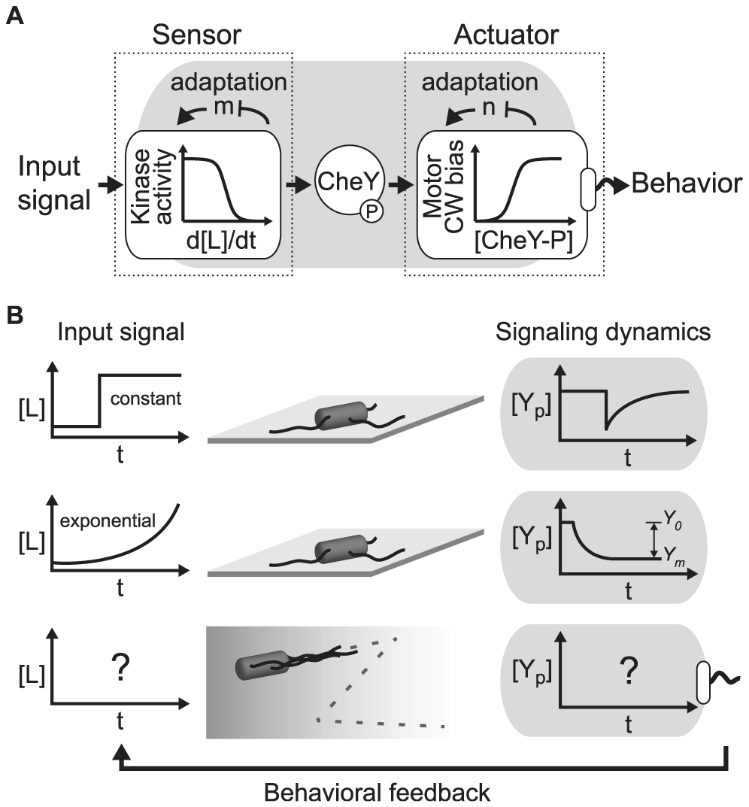

**学术原图 O07｜感觉与运动不能脱离闭环。** A概括感觉模块、CheY-P与运动模块；B对比预设刺激与自由移动采样，底部箭头将行为反馈接回感觉输入。这是原始模型研究的机制示意，曲线不能称为本报告或该文新记录的全部实验轨迹。相关公式勘误已登记。出处：Dufour等（2014），Fig.1，[C16](REFERENCES.md#C16)；CC BY 4.0，原图未改动。[完整图源与许可](FIGURES.md#O07)

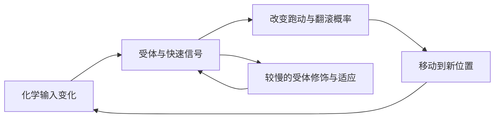

图3．细菌通过运动采样环境，再用适应回路比较近期背景。箭头表示功能关系，不是实验操作流程。[C01–C04](REFERENCES.md#C01)

在这类趋化实验中，可测量的决策变量是运动方向改变的概率。受体适应使该概率依赖近期刺激，要判断是否发生行为学习还需要其他实验。

### 7.2 草履虫的膜电反应与纤毛运动

草履虫的机械刺激响应与刺激部位有关：前部刺激可引起去极化、纤毛反转与后退，后部刺激则可引起不同膜反应及前进变化。经典电生理把膜反应与纤毛反转联系起来，后续分子研究进一步支持纤毛电压门控钙通道的作用。[C05](REFERENCES.md#C05)、[C06](REFERENCES.md#C06)、[C07](REFERENCES.md#C07)

可概括为：**局部刺激 → 膜电与钙状态改变 → 纤毛动力改变 → 后退、重新定向 → 恢复前进。** 同一个细胞不同部位承担感知、状态保持和运动输出。膜反应还具有渐变性质，不宜为了图示方便而把它全部说成理想二元开关。

可兴奋膜也不等于神经元，更不等于神经元间的突触网络。相似的是电化学状态能够控制运动这一功能，不能把功能相似直接写成器官相同。

### 7.3 喇叭虫的层级回避行为

Dexter等在Stentor roeseli中观察到统计上的层级回避：弯曲或纤毛变化、收缩、脱附等动作的出现具有组织性。然而个体差异很大，并非每次都执行固定四步序列；完整分子逻辑也未被鉴定。[C08](REFERENCES.md#C08)

因此可以说“无神经元细胞能表现出有层级的动作选择”，不能说“已经找到了一个确定性决策树”，也不能把这项研究直接作为习惯化或条件作用的证据。论文专门区分了这些现象；2020年勘误修正表格记录，作者声明不改变结论。[C08](REFERENCES.md#C08)、[C08c](REFERENCES.md#C08c)

### 7.4 多头绒泡菌的管网变化与胞外痕迹

多头绒泡菌营养体是多核巨大单细胞。它的管网既运输胞质，也参与协调：营养刺激后的收缩变化与流动传播相联系，实验和模型支持二者相互反馈。这里并不是把某种“想法”从一端传到另一端；信号的具体化学身份在相关研究中仍未完全确定。[C11](REFERENCES.md#C11)

Kramar与Alim发现，营养位置可在管径层次的持久改变中留下痕迹，进而影响后续流动和迁移。Reid等则显示，胞外黏液痕迹能够帮助回避重复经过的区域；破坏这种信息条件，会损害特定导航任务表现。[C12](REFERENCES.md#C12)、[C13](REFERENCES.md#C13)

这里至少有两种不同“记忆”：身体内部结构的历史改变，以及环境保留的外部标记。它们都可以通过当前反馈影响动作，不要求一个集中存储所有经历的记忆器。

迷宫连通与城市点位构网研究展示了自适应管网的能力，但任务中的短路径或网络权衡不能升级为任意图问题的最优性保证，更不说明菌体理解人类交通规划。[C09](REFERENCES.md#C09)、[C10](REFERENCES.md#C10)

### 7.5 区分适应、习惯化与联想学习

必须按证据分别回答：

| 现象 | 合适解释 | 还不能推出什么 |
|---|---|---|
| 刺激后受体灵敏度重新调整 | 生理适应、近期历史依赖 | 已形成行为学记忆或联想 |
| 管径或胞外痕迹影响后来行动 | 结构记忆或外部记忆的功能定义 | 有情景记忆或内部认知地图 |
| 重复刺激后回避减弱，停刺激后恢复，并保留刺激特异性 | 支持行为学意义的习惯化，即非联想学习 | 已具备普遍条件作用、通用推理或意识 |
| 多种动作按统计层级出现 | 层级动作选择 | 已知其全部分子实现 |

Boisseau等的多头绒泡菌研究支持其所操作定义的习惯化：反应减弱、恢复以及刺激特异性的组合，有助于排除若干简单解释。但分子存储机制尚未由该行为实验确定，也没有因此排除所有替代机制。[C14](REFERENCES.md#C14)

Yoneoka与Takamatsu随后把行为与形态联系起来：重复经历伴随跨越行为和管网形态变化，改变或破坏此前管网后的行为指标也会改变。这支持形态参与行为表达，但作者明确指出管网形态不足以单独解释全部行为，提出的厚度振荡泵机制也未获直接证明。[C17](REFERENCES.md#C17)

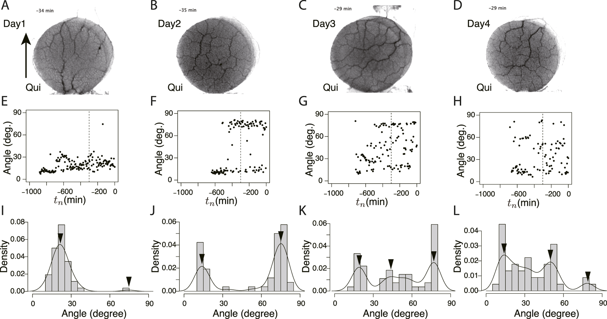

**学术原图 O09｜看见身体结构的历史变化。** 上排是第1至第4天的代表性管网照片，中、下排是方向随时间变化与方向分布。照片是示例，不代表全部样本；它也不是前文2021年管径记忆研究的原图。出处：Yoneoka与Takamatsu（2023），Fig.7，[C17](REFERENCES.md#C17)；CC BY 4.0，原图未改动。[完整图源与许可](FIGURES.md#O09)

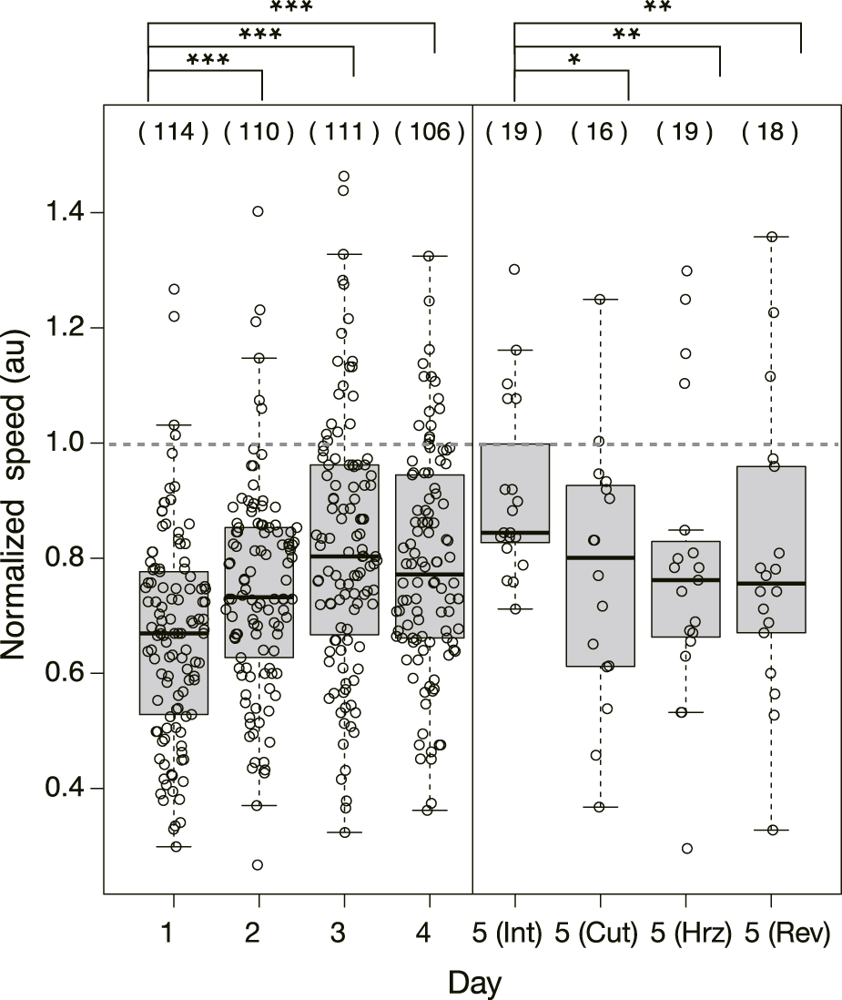

**学术原图 O08｜用行为数据检验形态解释。** 纵轴按同日对照平均速度归一化；括号中的样本数、箱线、单个数据点和显著性标记均保留原文口径。第5天各组的管网处理或朝向不同，不能只看天数就当作所有个体的同一连续轨迹。完整组别与统计定义见官方图页，本报告未重算这些统计。出处：Yoneoka与Takamatsu（2023），Fig.5，[C17](REFERENCES.md#C17)；CC BY 4.0，原图未改动。[完整图源与许可](FIGURES.md#O08)

变形细胞的研究还提出局部兴奋、全局抑制偏置可兴奋网络的机制：自发产生的局部活动被梯度偏置，与细胞骨架运动相联系。这说明单细胞也可以进行空间选择，但它与细菌的时间比较属于不同实现，不能合并成一种通用细胞决策算法。[C15](REFERENCES.md#C15)

## 8. 比较案例：乌鸦的视觉选择与反应时

### 8.1 运动方向辨别任务与计时口径

Schmidbauer 与 Nieder 训练两只小嘴乌鸦（*Corvus corone*）判断随机点的运动方向。每次试验要求在左、右或上、下两个方向中选择，运动一致性从 0% 到 81% 不等。果蝇的气味判别实验同样考察感觉证据不充分时的选择，但两项研究的刺激、训练过程和作答动作不同。[N06](REFERENCES.md#N06)、[E01](REFERENCES.md#E01)、[E02](REFERENCES.md#E02)

研究者从运动刺激出现开始计时，到鸟头离开红外光栅、启动作答动作为止。这段时间包含感觉处理和运动准备。两只鸟分别完成 55 场和 102 场记录。先取每场正确试次及全部 0% 一致性试次的中位反应时，再求跨场均值，两只鸟的结果分别为 235 ± 2 毫秒和 235 ± 1 毫秒。[N06](REFERENCES.md#N06)

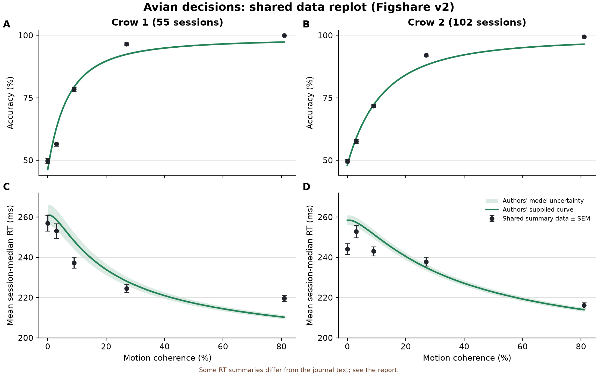

**开放数据复绘 D01｜对应原文Fig.1B–C的行为结果。** 上排为正确率，下排为每场中位反应时的跨场均值；黑点误差棒为作者提供的SEM，绿色曲线和色带来自作者开放版本的模型预测及其附带不确定性数据。左、右为两只鸟，分别55、102场。图中只载入公开汇总数组，没有重新拟合模型，也没有将场次当作独立动物。数据版本为[作者Figshare v2](https://doi.org/10.6084/m9.figshare.33205326.v2)，许可CC BY 4.0；这是数据复绘，**不是期刊原图截图**。输入、汇总表和复绘脚本见[图源记录](FIGURES.md#D01)。[N06](REFERENCES.md#N06)、[N07](REFERENCES.md#N07)

**版本差异：**公开数组中乌鸦2在3%一致性下约为252.756毫秒，而期刊正文给出的该鸟反应时范围为216–243毫秒；乌鸦1在0%条件下的公开值约256.984毫秒，正文写约254毫秒。开放数组与期刊图文的部分汇总值及所提供模型曲线不完全一致，本次未获差异原因。D01忠实显示开放版本，不用于替换期刊报告值，也不声称精确复现期刊图。[N06](REFERENCES.md#N06)、[N07](REFERENCES.md#N07)

### 8.2 动作启动前的方向选择性活动

研究者在两只鸟的尾外侧巢皮层（NCL）共记录了 248 个神经元，其中 58 个达到论文规定的方向选择性标准。这一采样结果尚不足以确定完成任务所需的最小回路。[N06](REFERENCES.md#N06)

方向选择群体的活动在刺激后约70毫秒已能区分偏好与非偏好方向，按动作时刻对齐则约在动作前170毫秒出现分离。这是两种对齐分析下的群体结果，不能把70与170毫秒相加解释为固定的处理流水线。0%运动和错误试次分析仍能读出与所选方向有关的信息，帮助区分纯刺激编码与选择相关编码。[N06](REFERENCES.md#N06)

证据更强时，部分群体活动上升得更快；按反应时分组后，活动在动作启动附近近似汇聚。这与积累后作出选择的解释相容，但**记录与解码不是因果干预**：本研究没有证明NCL单独完成积累，也没有识别从感觉输入到肌肉输出的全部必要线路。[N06](REFERENCES.md#N06)

### 8.3 模型拟合与跨物种比较的限制

标准漂移扩散模型中“一致性到漂移率的线性映射”没有很好描述这两只鸟的数据；作者比较的非线性映射改善了拟合，其中对数映射表现较好。这不等于证明所有鸟脑都按同一对数函数计算。活动在动作前的近似汇聚也不完整，作者明确保留了简单固定阈值之外的解释；组间差异未达显著不能证明阈值完全相同。[N06](REFERENCES.md#N06)

“比人或猴快约两倍”主要来自与既有相近任务研究的比较，不是本实验内对鸟、人、猴进行完全相同输入、训练和运动输出的配对试验。因而这里更稳妥的结论是：**不同脑组织可以实现相近的证据整合功能，并在特定任务中具有很不同的反应时。** 这篇论文没有给出单位神经元、单位能量的统一效率比较。[N06](REFERENCES.md#N06)

期刊原图和开放数据的许可分别列于[图源记录](FIGURES.md)。读者可查阅论文的[图 1](https://www.science.org/doi/10.1126/science.aed6459#F1)、[图 2](https://www.science.org/doi/10.1126/science.aed6459#F2)、[图 3](https://www.science.org/doi/10.1126/science.aed6459#F3)及[图 4](https://www.science.org/doi/10.1126/science.aed6459#F4)。

## 9. 跨物种比较中的共性与差异

各项研究可以按三个问题比较：系统保留了什么信息，这些信息如何影响动作，现有实验能否区分不同机制。

| 机制 | 在任务中的作用 | 实验证据及适用范围 |
|---|---|---|
| 使用任务相关变量 | 方向、熟悉度、近期变化等变量可以指导动作，不必保存所有环境细节 | 果蝇方向码与蚂蚁导航；不等于动物永远没有更复杂表示 |
| 递归保持与时间积分 | 同一回路在时间中反复更新状态，不必为每个历史时刻增加一层 | 环吸引子、树突积累、细菌反馈；不同系统不是同一种电路 |
| 已有结构与经验读出配合 | 学习可以调整局部关联，不必每次从零形成整个控制系统 | 蘑菇体突触可塑性；不能由此量化进化与学习各贡献多少 |
| 局部执行与分布式反馈 | 高层不必逐毫秒计算每个运动器官的完整轨迹 | BANC与CPG；完整活体因果链仍有空缺 |
| 借助身体和环境保存信息 | 形态及环境痕迹可以成为之后输入的一部分 | 黏菌管径与胞外标记；外部环境也会破坏或污染痕迹 |
| 使用概率和廉价代理变量 | 不必在每次行动前求解完整最优问题 | 细菌运动偏置、蚂蚁相遇率和向量长度；有效性依赖环境 |

进化与发育提供了什么，也是理解效率的必要背景：一个已经成形的动物并不是随机初始化后才第一次寻找所有有用回路。不过，本报告没有比较世代选择、发育过程与个体学习的信息预算，不能据此给出“多少知识来自基因”的数值结论。

“低维状态”尤其容易被误读。它可以表示观测到的活动主要沿少数方向变化；不表示生成这些轨迹的系统只需要同样少的神经元，也不保证换任务后仍然低维。[W02](REFERENCES.md#W02)、[W04](REFERENCES.md#W04)

## 10. 生物系统与人工模型的规模指标

**神经元数、突触数、可训练参数数和运行状态数不是同一种资源。** 真实神经元可以有树突积分、膜时间常数、不同受体效应与调质；一个连接组的图边也可能汇总多个突触。若把这些都压缩成一个人工节点，压缩后的计算代价与误差必须另算。[E01](REFERENCES.md#E01)、[F01](REFERENCES.md#F01)

Lappalainen等2024年的视觉系统模型提供了具体例子：模型展开后有45,669个神经元与约151万个突触，但因细胞类型和空间共享约束，使用734个自由参数。其功能预测还依赖任务优化；734不能叫作真实果蝇全部视觉信息的参数预算，更不能叫作完整脑的规模。[N05](REFERENCES.md#N05)

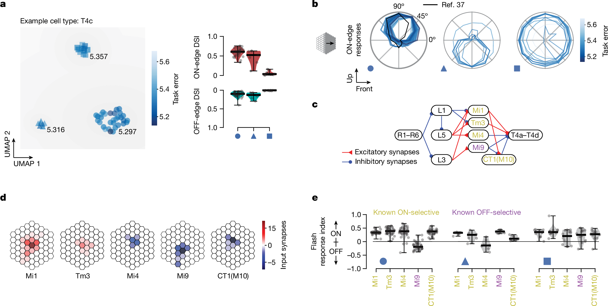

**学术原图 O05｜约束很强，模型解仍不一定唯一。** 图中模型集在T4c方向调谐上形成不同簇，并联系到输入通路差异；与已知调谐相符的解可以用来提出实验假说。多数曲线是模型输出，图中注明文献来源的比较线与活体测量需区分。出处：Lappalainen等（2024），Fig.3，[N05](REFERENCES.md#N05)；CC BY 4.0，原图未改动。[完整图源与许可](FIGURES.md#O05)

Shiu等的2024模型则使用连接组与预测递质身份，生成喂食、梳理通路的可检验预测，并验证了其中一些。它仍简化了神经元差异，忽略或不足以表示缝隙连接、非脉冲细胞、内部状态及长程神经肽等因素。[N04](REFERENCES.md#N04)

比较两类模型的效率，需要统一任务、输入、身体条件、训练经历、评价指标和运行成本。所引研究尚不足以估算果蝇与人工模型之间的统一效率比。

## 11. 研究结论与待验证问题

| 问题 | 本次证据判断 | 仍缺什么 |
|---|---|---|
| 小神经系统能否保存状态并选择动作 | 有生理、行为与干预证据 | 各任务的完整闭环及跨环境泛化 |
| 乌鸦的快速选择是否具有积累相关信号 | 两只鸟的行为、记录和解码与该解释相容 | 因果必要性、跨个体泛化及统一跨物种比较 |
| 果蝇如何把当前方向与目标转为转向 | 特定任务已有较直接通路证据 | 全部自然行为中的参与范围 |
| 节律是否可以由很小的回路产生 | 模型中有明确候选，部分下降通路已实测 | 核心细胞逐一活体验证、完整运动解释 |
| 蚂蚁如何结合导航线索 | 行为与部分脑区干预较充分 | 逐神经元的完整计算链 |
| 蚁群怎样形成统一行为 | 招募、相遇率与阈值有实证 | 各物种间机制差异与完整信号分工 |
| 无神经元细胞能否表现历史依赖与动作选择 | 有直接实验支持 | 不同现象的精确分子实现 |
| 这些行为是否意味着意识 | 这些研究不能确立 | 独立、适用且能排除替代解释的意识证据 |
| 复制连接图是否等于复制动物 | 现有模型不足以支持这个等同 | 电生理、调质、可塑性、身体与环境的共同验证 |

后续实验需要在同一任务中分别改变候选状态变量、反馈通路和环境条件，观察哪些改变会影响选择。只有这样，才能区分随动作共同变化的信号与产生动作所必需的环节。

## 12. 紧凑控制器的实验设计

果蝇的方向比较与局部节律回路为控制器设计提供了两种参照。下列问题可在人工系统中分别检验。[方向比较](REFERENCES.md#F05) · [局部节律](REFERENCES.md#N03)

1. **状态保持。** 在任务、训练数据和参数预算相同的条件下，比较保留递归状态与每一步重置状态的策略，记录两者在需要利用近期刺激时的表现。

2. **局部反馈。** 固定身体模型，分别保留、移除或延迟局部感觉反馈，比较完成同一动作所需的高层控制以及运动误差。

3. **连接结构。** 固定网络规模、输入输出、训练条件和初始化方案，将生物连接模板与保留节点度数的随机网络比较，检验特定连接关系能否改善任务表现。[连接组模型](REFERENCES.md#N04) · [视觉模型](REFERENCES.md#N05)

这些实验衡量的是给定控制器的表现。将结果用于解释生物行为，还需要与相应物种的干预实验对照。

## 13. 结论

要解释生物为什么在某一刻转向，可以先问此前的哪项信息仍在起作用。果蝇转向时可利用当前朝向与目标朝向的偏差；细菌改变运动方向的概率取决于近期浓度变化；绒泡菌此前接触营养的位置则能在管网结构中留下痕迹。相似的运动结果可以来自不同的生理过程。

跨物种比较最有解释力的单位是具体任务。若要确定某段回路、某种膜电变化或某项结构变化对动作是否必要，还须在改变该因素后测量行为，并检查其他条件下是否仍有同样的结果。

---

**阅读与复核入口：**[完整文献](REFERENCES.md) · [学术图源与许可](FIGURES.md) · [结构化来源](sources.json) · [关键命题证据表](EVIDENCE.md) · [检索方法及局限](METHODS.md)

第一方文字沿用仓库的 [Proof of Love2 许可声明](../../../LICENSE)。第三方原图及开放数据保留原署名与许可，详见[图源记录](FIGURES.md)。文献核读范围与审校状态见[方法说明](METHODS.md)。
