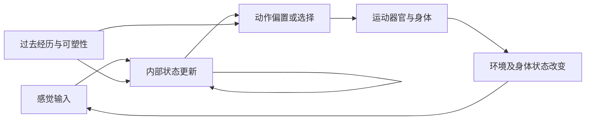
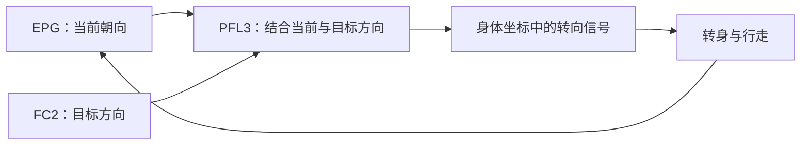
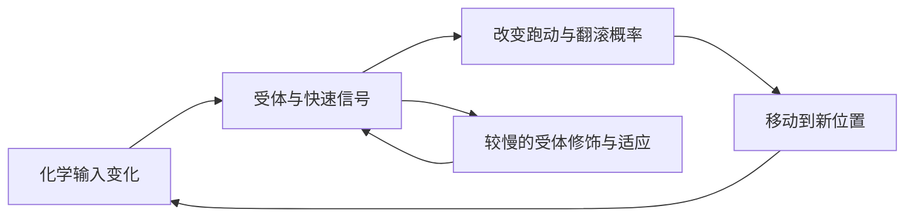

# 小神经系统与无神经元细胞如何形成动作决策

**蚂蚁、果蝇、线虫与单细胞生物的跨尺度证据报告**

调查日期：2026年11月17日（UTC+8）

材料状态：AI辅助专题调研，已按原始来源作机器辅助核读，尚未经过独立人工逐条审校；未开展新的生物实验。

本报告回答：**当神经系统很小，甚至根本没有神经元时，生物怎样把感知变成有适应意义的动作？** 正文中的 F、W、E、A、C、N 编号均链接到[文献与核读范围](REFERENCES.md)；[来源清单](sources.json)另存每项支持命题和局限。检索方法与访问缺口见[方法说明](METHODS.md)。

## 摘要

小生物能够行动，不是因为在很少的神经元中隐藏了一套缩小版的人类思考程序。现有证据更支持：**专门化的感觉处理、能够保留状态的递归动力学、依赖经验的读出、局部动作回路，以及身体与环境的反馈，共同构成动作控制。** “决策”可以是运动方向、动作持续时间或切换概率的改变，不必先出现语言、符号推演或意识。

果蝇提供了较直接的神经机制证据：方向活动峰可被回路维持；当前朝向和目标朝向可转换为转向信号；蘑菇体输出偏置接近或回避；树突膜电位能够积累不确定证据。蚂蚁的导航把步态、天光、视觉记忆等信息结合起来，群体选巢则另外利用招募与相遇频率。单细胞没有神经网络：细菌以生化反馈比较近期输入，草履虫以膜电和纤毛钙控制回避，多头绒泡菌把部分历史保存在管径结构和环境痕迹中。[F03–F07](REFERENCES.md#F03)、[E01–E02](REFERENCES.md#E01)、[A02–A10](REFERENCES.md#A02)、[C01–C15](REFERENCES.md#C01)

截至本次调查，2026年的果蝇全中枢连接组与步行节律研究进一步支持分布式控制，但不能据此声称已经完整复制一只果蝇，也不能把仿真中的三细胞节律核说成完成全部行走决策的最小大脑。[N01](REFERENCES.md#N01)、[N02](REFERENCES.md#N02)、[N03](REFERENCES.md#N03)

## 1. 先澄清：小的究竟是什么

### 1.1 神经元少、身体小、状态少，是三个不同命题

蚂蚁和果蝇有神经系统；单细胞生物没有神经元间构成的神经网络。细胞内部却存在受体、信号蛋白、膜电、离子、细胞骨架与形态变化。这些变量可以相互作用，也可以携带过去输入的影响。因此，细胞应列为“无神经元”，而不是“只有一个神经元”。[C04](REFERENCES.md#C04)、[C07](REFERENCES.md#C07)、[C12](REFERENCES.md#C12)

身体小也不意味着任务简单。需要分别考察：它感知哪些变量，动作有多少自由度，需要保持多长时间的历史，必须在何种环境变化下继续有效。神经元总数本身不能回答这些问题。下表只比较计数口径，不构成智能排名。

| 对象与数据 | 可以使用的规模 | 必须保留的口径 | 来源 |
|---|---:|---|---|
| 秀丽隐杆线虫，成年雌雄同体 | 302个神经元 | 全动物神经系统；成年雄虫为385，不能混用 | [W01](REFERENCES.md#W01) |
| 黑腹果蝇，首龄幼虫脑，2023 | 3,016个神经元；约548,000个突触位点 | 包括480个输入神经元与2,536个已分化脑神经元；不是成虫，也不是全部中枢 | [F02](REFERENCES.md#F02) |
| 黑腹果蝇，成年雌性脑，2024 | 139,255个神经元；5,450万个化学突触链接 | 包括中央脑与两侧视叶，不含完整腹神经索 | [F01](REFERENCES.md#F01) |
| 黑腹果蝇，BANC，2026 | 155,916个已校对或粗校对神经元 | 雌性脑与腹神经索的联合重建；缺失部分区域，校对完整度不同，不能当精确全身总数 | [N01](REFERENCES.md#N01) |
| 黑腹果蝇，MaleCNS，2026 | 166,700个神经元，含感觉轴突；1.242亿突触链接 | 雄性脑与腹神经索；神经元对之间约2,560万条图边，与突触数不同 | [N02](REFERENCES.md#N02) |
| 蚂蚁，Novomessor spp.的特定研究 | 不同方法约7万与9万**总脑细胞** | 含胶质细胞，不能改写成神经元；也不能推广为所有蚂蚁 | [A01](REFERENCES.md#A01) |
| 大肠杆菌、草履虫、喇叭虫 | 无神经元 | 分子或膜电网络不按神经元数计量 | [C01](REFERENCES.md#C01)、[C07](REFERENCES.md#C07)、[C08](REFERENCES.md#C08) |
| 多头绒泡菌营养体 | 无神经元；多核巨大单细胞 | 单细胞并不意味着微小或单核，不能与细菌按“一个细胞”直接比较复杂度 | [C11–C14](REFERENCES.md#C11) |

2024与2026的果蝇数字来自不同标本、性别、覆盖范围和重建版本，不能用差值推导性别造成多少神经元增长。昆虫一个突触前结构可连接多个突触后对象；突触链接、突触前结构、神经元对图边，也不能互换。[F01](REFERENCES.md#F01)、[N01](REFERENCES.md#N01)、[N02](REFERENCES.md#N02)

本报告以黑腹果蝇作为“苍蝇”的主要神经科学实例。果蝇不是家蝇，也不代表所有双翅目昆虫；选择它是因为本次能取得较完整的连接组、生理和干预证据。

### 1.2 “形成动作决策”的操作定义

本报告采用一个可测量、较少拟人化的定义：**当前输入与内部状态共同决定动作的方向、强度、持续时间，或从一种动作切换到另一种动作的概率。** 这个定义允许随机选择，也允许连续调节；不预设细胞或动物具有主观体验。

应分开四层问题：

1. **表征：**系统保存了什么，如当前朝向或近期刺激背景。
2. **选择：**这些状态怎样偏置左转、右转、接近、回避或等待。
3. **执行：**肌肉、纤毛或形变怎样产生运动。
4. **学习：**经历怎样改变之后的映射。

观察到动作，未必已经找出选择机制；找到节律发生器，也未必解释了何时开始走、朝哪里走。

## 2. 一个共同框架：带状态的感知—动作闭环

下图是跨研究的功能综合，不表示不同物种使用同一解剖结构。

图1．闭环允许系统把计算分散到神经或分子动力学、身体与环境。内部状态的自连接表示历史依赖，不要求一定有神经突触。依据方向保持、线虫状态反馈、细菌适应和黏菌结构记忆综合绘制。[F03](REFERENCES.md#F03)、[W03](REFERENCES.md#W03)、[C04](REFERENCES.md#C04)、[C12](REFERENCES.md#C12)

可以用以下一般状态空间表达式帮助理解；它是本报告的分析记号，不是任何一种动物已经被完整识别的真实方程：

$$
x_{t+1}=F(x_t,s_t,b_t;\theta),\qquad
a_t\sim\pi(a\mid x_t,s_t,b_t).
$$

其中，$s_t$ 是感觉输入，$x_t$ 是神经或分子状态，$b_t$ 是身体状态，$\theta$ 表示相对缓慢的结构或可塑性参数。动作改变身体与下一次输入。学习可以改变 $\theta$；短期保持也可以只改变 $x_t$，两者不是同一件事。

这解释了为何不能把小动物理解为“每帧独立判断的一张小分类表”：近期行为和回路状态会影响下一步。线虫中，改变刺激到来之前的网络状态，会改变之后神经与行为响应的可靠性，就是这种历史依赖的直接实例。[W03](REFERENCES.md#W03)

## 3. 果蝇：从几个可验证的计算环节看动作决策

### 3.1 方向不是一张地图，而可以是一个活动峰

Seelig与Jayaraman在受控视觉环境中发现，果蝇相关神经元群体的活动峰随朝向移动；有地标时受视觉约束，黑暗中仍能根据自身运动更新。Kim等随后用光干预改变方向活动表征，发现回路能够维持被设定的状态，支持环吸引子机制。[F03](REFERENCES.md#F03)、[F04](REFERENCES.md#F04)

直观地说，环上的峰位置就是一个方向变量：需要保持的是“现在朝哪”，而不必每时每刻重建周围世界的全部细节。递归相互作用使表征持续，自运动使它平移，外界线索可以校正漂移。这是小网络保存连续状态的一种方式；它本身还没有回答应该朝哪里走。

### 3.2 当前方向与目标方向的比较，怎样变成转向

2024年Mussells Pires等给出更接近动作选择的证据：EPG群体表示当前朝向，FC2活动与目标朝向相关；PFL3结合两类信息，输出与身体左右转向有关的信号。局部刺激FC2可以引导果蝇按实验设定的方向前行，PFL3干预的结果与模型预测相符。[F05](REFERENCES.md#F05)

图2．该图概括具体导航任务中的已研究通路；省略中间及平行回路，不代表所有动作都由这一比较器决定。[F05](REFERENCES.md#F05)

这一实例回答了问题的核心：**动作决策不一定要先用语言描述目的，再穷举动作；结构化群体码之间的变换就能把目标偏差变成转向。** 有目标方向表征，也不等于证明存在人类式主观意图。

### 3.3 经验怎样改变下一次选择

蘑菇体中，Kenyon细胞提供稀疏感觉表示，输出神经元群体影响接近与回避。Aso等的光激活实验支持输出平衡对行为偏向的作用；Hige等进一步发现，气味与特定多巴胺活动配对，可以产生气味特异、区室受限且依赖时间顺序的突触改变。[F06](REFERENCES.md#F06)、[F07](REFERENCES.md#F07)

因此，动物再次遇到某种气味时，不必重新播放全部经历：经验已改变了感觉表示到行为价值的读出。这里的“价值”指接近或回避倾向，不是道德评价。蘑菇体输出也不是每块肌肉的直接指令；价值读出和动作执行仍需分层理解。

### 3.4 小回路也可以等证据变充分

气味判别困难时，果蝇往往反应更慢、准确率更低，行为能由证据积累模型描述。单靠这样的速度—准确率关系，还不能唯一确认神经实现。[F08](REFERENCES.md#F08)

后续研究把问题推进到生理层面：在该气味判别任务中，αβ核心Kenyon细胞亚群的树突亚阈膜电位能够对感觉输入作时间积分；改变相关电流会改变放电潜伏期和判别时间。2023年的短暂去极化干预还能够加快具体气味判别，伴随较小的准确率代价，支持积累过程对动作承诺时间的贡献。[E01](REFERENCES.md#E01)、[E02](REFERENCES.md#E02)

这说明一个生物神经元不是一个没有内部结构的加权求和点。膜电与树突性质本身可以承担时间计算。但不能把“少数细胞参与积累”扩写为“一个细胞独立完成全部决策”。早期FoxP在特定成年Kenyon细胞中的表达定位也存在研究分歧，本报告不把该定位当作既定事实。[E03](REFERENCES.md#E03)

### 3.5 决定走，不等于逐次计算每条腿的摆动

2026年10月的Pugliese等研究，在连接组约束的仿真中筛出由两个兴奋性、一个抑制性中间神经元构成的节律核；相关结构在多个连接组和腿部区域中得到比较。研究还对下降通路驱动的腿部节律作了实验验证。[N03](REFERENCES.md#N03)

应区分三层结论：

| 层次 | 这项研究支持什么 | 不能推出什么 |
|---|---|---|
| 仿真内核 | 特定简化回路在模型中对节律具有必要性与充分性 | 活体中三个细胞已被逐一证实为全部行走所必需且充分 |
| 通路实验 | DNg100、DNb08相关预测得到部分行为验证 | 所有模型内部机制均已验证 |
| 完整行走 | 节律生成可以由小回路承担 | 三个细胞即可实现导航、平衡、六足协调与全部选择 |

这个结果的重要性在于提供可检验的紧凑机制，而不是一个脱离任务、身体和其余网络的“最小智能数字”。

### 3.6 2026年的连接组为什么改变了“总司令”图景

BANC把脑与腹神经索连接起来。其结构分析发现，效应神经元通常受到同一身体部位感觉输入的较强影响，局部反馈单元之间再通过上行、下降和其他长程连接协调。作者据此提出，中央复合体与蘑菇体对部分行为起监督作用，而不是所有动作必经的唯一中央控制器。[N01](REFERENCES.md#N01)

这是基于大规模解剖与影响模型的证据，不能改写为已直接测得每条连接的因果作用。该影响指标采用简化线性动力学，连接权重按非负值处理；它适合提出网络组织假说，不等价于含抑制、调质和身体反馈的完整生理仿真。联合重建也仍有区域缺失及校对完整度限制。[N01](REFERENCES.md#N01)

MaleCNS则提供雄性脑与腹神经索的另一份大规模资源。它推进了性别间线路比较，仍然是一张结构图；作者明确保留了功能实验验证的必要性。[N02](REFERENCES.md#N02)

## 4. 线虫：302个神经元为什么不是302个动作按钮

成年雌雄同体线虫的302个神经元是一个清楚的规模参照，但不能据此想象成每个神经元各对应一个动作。Kato等发现，分布式群体活动形成可对应运动命令序列的低维轨迹；Gordus等表明，同样的气味输入可以因先前网络状态不同而产生不同的响应概率。[W01](REFERENCES.md#W01)、[W02](REFERENCES.md#W02)、[W03](REFERENCES.md#W03)

自由运动条件下的后续脑广域记录进一步显示，一些细胞共同表示多种行为，一些活动保留近期动作的影响，编码关系也会随状态改变。这更接近“共享网络在不同动态状态中组织行为”，而不是固定按钮盒。[W04](REFERENCES.md#W04)

证据边界同样重要：2015年Kato研究的主要脑广域成像在固定动物中完成，每只检测的是部分神经元，再通过代表细胞的自由运动记录建立行为映射；不能说当时已经同时记录自由运动线虫的全部302个神经元。低维轨迹描述和行为编码，也不自动证明少数状态变量已对全部动作因果充分。[W02](REFERENCES.md#W02)

## 5. 蚂蚁个体：用可组合的信息，而不是重建整个世界

### 5.1 返回巢穴，需要哪些状态

对已研究的沙漠蚁而言，返巢可利用距离与方向相关的信息。Wittlinger等改变Cataglyphis fortis的步幅后，返巢距离判断出现系统性偏差；结果支持与步态、自运动有关的距离积分，不表示蚂蚁在字面数步。[A02](REFERENCES.md#A02)

Wehner与Müller对同种蚂蚁的太阳与偏振天光操控，支持天光罗盘的作用；在他们的实验条件中，偏振天光并非只在太阳不可见时才使用的备用线索。[A03](REFERENCES.md#A03)

一种有帮助的计算表达是：动物持续更新“相对巢穴的位移向量”，返程时按其反方向移动。这是对路径积分的功能说明，不是已经定位全部蚂蚁神经回路的真实代码。积分会积累误差，视觉等信息则提供额外约束；不同蚁种不能一概而论。

### 5.2 学到的场景怎样影响转向

在Formica rufa中干预蘑菇体，会损害学到的视觉导航，但大型视觉线索引起的某些先天趋向仍保留。Myrmecia midas自然场景返巢研究也发现，蘑菇体垂直叶干预损害定向。[A05](REFERENCES.md#A05)、[A06](REFERENCES.md#A06)

这组证据把学习相关导航与部分基础视觉行为分开：视觉输入不只触发一个固定动作，记忆会改变它的读出。蘑菇体启发的稀疏编码模型也展示了路线记忆的计算可行性，但模型中能存储多少场景，不能改写成已经在活蚂蚁脑里数出多少张照片。[A07](REFERENCES.md#A07)

2026年Wystrach等进一步在Cataglyphis velox与Myrmecia croslandi中研究侧向视觉记忆。行为结果与模型支持：熟悉场景可以先提供目标在左侧或右侧的信息，再结合罗盘参照更新目标方向。这与果蝇当前方向—目标方向比较的研究形成可讨论的联系。[A08](REFERENCES.md#A08)、[F05](REFERENCES.md#F05)

但两者的证据强度不同：蚂蚁研究中的完整蘑菇体—中央复合体信号定位仍含模型假设和跨物种推断，不能写成已在蚂蚁中逐神经元验证了果蝇同样的线路。

### 5.3 行为接近最优，不等于脑中显式计算概率

在返巢向量与视觉记忆冲突时，Cataglyphis velox会改变线索权重；2015年研究发现，最优整合模型能很好描述某些结果。但解耦变量的试验还支持一种较简单解释：蚂蚁可能把返巢向量长度用作可靠性代理，而非逐次显式计算不确定性。[A04](REFERENCES.md#A04)

这是一条关键方法论：**同一种看起来聪明的行为，可能由不同复杂度的实现产生。** 判断是否需要复杂算法，应使用能区分候选机制的干预与对照，不能只看最终路径是否漂亮。

## 6. 蚁群：社会反馈扩展了决策系统，但没有扩大单只蚂蚁的大脑

Pratt等对Temnothorax albipennis（原文旧名Leptothorax albipennis）的研究显示：招募者先通过串联带路增加评估者，当新巢中的支持程度达到阈值后，再切换到较快的搬运。少数个体直接比较候选地点，也可以通过相互作用产生较好的群体结果。[A09](REFERENCES.md#A09)

2005年的后续实验更具体：阻断触碰或改变巢的面积，会改变招募方式切换，支持相遇频率作为群体支持程度的代理。个体不需要逐一准确数人头，群体却能产生阈值行为。[A10](REFERENCES.md#A10)

2022年Gal与Kronauer比较Ooceraea biroi的不同群体规模，发现较大群体的协调撤离温度阈值更高。兴奋与抑制相互作用模型能够解释这种规模依赖，但具体接触、化学信号及其作用仍需进一步拆解。[A11](REFERENCES.md#A11)

| 层级 | 状态主要在哪里 | 动作或结果是什么 |
|---|---|---|
| 单只蚂蚁 | 个体神经活动、身体状态、学到的场景 | 转向、行走、招募或搬运 |
| 蚁群 | 个体状态分布、相遇与招募关系、巢中密度 | 形成集体迁移或选巢结果 |

“群体智能”在这里是群体层面的功能描述。它不能证明每只蚂蚁理解整个任务，也不意味着相遇网络在生理上就是神经网络；更不能由群体表现反推单蚁有多少神经元。

## 7. 没有神经元的细胞怎样选择动作

### 7.1 大肠杆菌：不必知道食物在哪，只需让有利运动持续更久

三维追踪研究表明，大肠杆菌趋化可以通过改变原本自发出现的重定向来实现：沿当前方向前进时，如果吸引物条件改善，就延长这一段运动；重新定向具有随机性，长时间累积后才出现向较好环境的统计漂移。[C01](REFERENCES.md#C01)、[C04](REFERENCES.md#C04)

关键是时间比较。Segall等的研究在其测试条件下发现，反应取决于近期约4秒的刺激历史，最近与稍早的输入具有相反权重。细胞并不需要保存一串文字记录，受体修饰和信号活性就是近期背景的状态载体；该时间尺度不能外推为所有菌株和环境的常数。[C02](REFERENCES.md#C02)

高层机制可概括为：输入改变受体与信号活性，信号改变运动切换概率，较慢的受体修饰反馈重设灵敏度。Barkai–Leibler模型及Yi等的控制理论分析说明，特定网络结构可以产生稳健适应，积分反馈是其中的机制解释；“完美适应”需要相应稳定性和模型假设。[C03](REFERENCES.md#C03)、[C04](REFERENCES.md#C04)

图3．细菌通过运动采样环境，再用适应回路比较近期背景。箭头表示功能关系，不是实验操作流程。[C01–C04](REFERENCES.md#C01)

它的“决策”是改变一个概率分布，不是确定性地知道食物在哪并向那里转弯。适应体现历史依赖，也不自动等于行为学学习。

### 7.2 草履虫：膜电与纤毛耦合，就能形成回避链

草履虫的机械刺激响应与刺激部位有关：前部刺激可引起去极化、纤毛反转与后退，后部刺激则可引起不同膜反应及前进变化。经典电生理把膜反应与纤毛反转联系起来，后续分子研究进一步支持纤毛电压门控钙通道的作用。[C05](REFERENCES.md#C05)、[C06](REFERENCES.md#C06)、[C07](REFERENCES.md#C07)

可概括为：**局部刺激 → 膜电与钙状态改变 → 纤毛动力改变 → 后退、重新定向 → 恢复前进。** 同一个细胞不同部位承担感知、状态保持和运动输出。膜反应还具有渐变性质，不宜为了图示方便而把它全部说成理想二元开关。

可兴奋膜也不等于神经元，更不等于神经元间的突触网络。相似的是电化学状态能够控制运动这一功能，不能把功能相似直接写成器官相同。

### 7.3 喇叭虫：行为有层级，但分子选择机制还没有完全找出

Dexter等在Stentor roeseli中观察到统计上的层级回避：弯曲或纤毛变化、收缩、脱附等动作的出现具有组织性。然而个体差异很大，并非每次都执行固定四步序列；完整分子逻辑也未被鉴定。[C08](REFERENCES.md#C08)

因此可以说“无神经元细胞能表现出有层级的动作选择”，不能说“已经找到了一个确定性决策树”，也不能把这项研究直接作为习惯化或条件作用的证据。论文专门区分了这些现象；2020年勘误修正表格记录，作者声明不改变结论。[C08](REFERENCES.md#C08)、[C08c](REFERENCES.md#C08c)

### 7.4 多头绒泡菌：历史可以存在身体形状和环境里

多头绒泡菌营养体是多核巨大单细胞。它的管网既运输胞质，也参与协调：营养刺激后的收缩变化与流动传播相联系，实验和模型支持二者相互反馈。这里并不是把某种“想法”从一端传到另一端；信号的具体化学身份在相关研究中仍未完全确定。[C11](REFERENCES.md#C11)

Kramar与Alim发现，营养位置可在管径层次的持久改变中留下痕迹，进而影响后续流动和迁移。Reid等则显示，胞外黏液痕迹能够帮助回避重复经过的区域；破坏这种信息条件，会损害特定导航任务表现。[C12](REFERENCES.md#C12)、[C13](REFERENCES.md#C13)

这里至少有两种不同“记忆”：身体内部结构的历史改变，以及环境保留的外部标记。它们都可以通过当前反馈影响动作，不要求一个集中存储所有经历的记忆器。

迷宫连通与城市点位构网研究展示了自适应管网的能力，但任务中的短路径或网络权衡不能升级为任意图问题的最优性保证，更不说明菌体理解人类交通规划。[C09](REFERENCES.md#C09)、[C10](REFERENCES.md#C10)

### 7.5 细胞有“学习”吗

必须按证据分别回答：

| 现象 | 合适解释 | 还不能推出什么 |
|---|---|---|
| 刺激后受体灵敏度重新调整 | 生理适应、近期历史依赖 | 已形成行为学记忆或联想 |
| 管径或胞外痕迹影响后来行动 | 结构记忆或外部记忆的功能定义 | 有情景记忆或内部认知地图 |
| 重复刺激后回避减弱，停刺激后恢复，并保留刺激特异性 | 支持行为学意义的习惯化，即非联想学习 | 已具备普遍条件作用、通用推理或意识 |
| 多种动作按统计层级出现 | 层级动作选择 | 已知其全部分子实现 |

Boisseau等的多头绒泡菌研究支持其所操作定义的习惯化：反应减弱、恢复以及刺激特异性的组合，有助于排除若干简单解释。但分子存储机制尚未由该行为实验确定，也没有因此排除所有替代机制。[C14](REFERENCES.md#C14)

变形细胞的研究还提出局部兴奋、全局抑制偏置可兴奋网络的机制：自发产生的局部活动被梯度偏置，与细胞骨架运动相联系。这说明单细胞也可以进行空间选择，但它与细菌的时间比较属于不同实现，不能合并成一种通用细胞决策算法。[C15](REFERENCES.md#C15)

## 8. 为什么这些机制不需要一个很大的通用网络

以下是对上述证据的综合解释，不是某篇论文已经统一验证的定律。

| 机制 | 节省了什么问题 | 实证锚点与边界 |
|---|---|---|
| 使用任务相关变量 | 方向、熟悉度、近期变化等变量可以指导动作，不必保存所有环境细节 | 果蝇方向码与蚂蚁导航；不等于动物永远没有更复杂表示 |
| 递归保持与时间积分 | 同一回路在时间中反复更新状态，不必为每个历史时刻增加一层 | 环吸引子、树突积累、细菌反馈；不同系统不是同一种电路 |
| 已有结构与经验读出配合 | 学习可以调整局部关联，不必每次从零形成整个控制系统 | 蘑菇体突触可塑性；不能由此量化进化与学习各贡献多少 |
| 局部执行与分布式反馈 | 高层不必逐毫秒计算每个运动器官的完整轨迹 | BANC与CPG；完整活体因果链仍有空缺 |
| 借助身体和环境保存信息 | 形态及环境痕迹可以成为之后输入的一部分 | 黏菌管径与胞外标记；外部环境也会破坏或污染痕迹 |
| 使用概率和廉价代理变量 | 不必在每次行动前求解完整最优问题 | 细菌运动偏置、蚂蚁相遇率和向量长度；有效性依赖环境 |

进化与发育提供了什么，也是理解效率的必要背景：一个已经成形的动物并不是随机初始化后才第一次寻找所有有用回路。不过，本报告没有比较世代选择、发育过程与个体学习的信息预算，不能据此给出“多少知识来自基因”的数值结论。

“低维状态”尤其容易被误读。它可以表示观测到的活动主要沿少数方向变化；不表示生成这些轨迹的系统只需要同样少的神经元，也不保证换任务后仍然低维。[W02](REFERENCES.md#W02)、[W04](REFERENCES.md#W04)

## 9. 为什么不能把神经元直接换算成人工网络参数

**神经元数、突触数、可训练参数数和运行状态数不是同一种资源。** 真实神经元可以有树突积分、膜时间常数、不同受体效应与调质；一个连接组的图边也可能汇总多个突触。若把这些都压缩成一个人工节点，压缩后的计算代价与误差必须另算。[E01](REFERENCES.md#E01)、[F01](REFERENCES.md#F01)

Lappalainen等2024年的视觉系统模型提供了具体例子：模型展开后有45,669个神经元与约151万个突触，但因细胞类型和空间共享约束，使用734个自由参数。其功能预测还依赖任务优化；734不能叫作真实果蝇全部视觉信息的参数预算，更不能叫作完整脑的规模。[N05](REFERENCES.md#N05)

Shiu等的2024模型则使用连接组与预测递质身份，生成喂食、梳理通路的可检验预测，并验证了其中一些。它仍简化了神经元差异，忽略或不足以表示缝隙连接、非脉冲细胞、内部状态及长程神经肽等因素。[N04](REFERENCES.md#N04)

两者展示的是不同建模路线的有效性与边界，不能合并成“只要下载连接组，就无需参数、学习、身体模型和功能验证地复制了整只动物”。与大型人工模型比较时，还需匹配任务范围、输入方式、身体、训练经历、评价指标及运行成本；本次文献没有提供足以计算统一效率倍数的比较基础。

## 10. 哪些已经比较清楚，哪些仍然没有解决

| 问题 | 本次证据判断 | 仍缺什么 |
|---|---|---|
| 小神经系统能否保存状态并选择动作 | 有生理、行为与干预证据 | 各任务的完整闭环及跨环境泛化 |
| 果蝇如何把当前方向与目标转为转向 | 特定任务已有较直接通路证据 | 全部自然行为中的参与范围 |
| 节律是否可以由很小的回路产生 | 模型中有明确候选，部分下降通路已实测 | 核心细胞逐一活体验证、完整运动解释 |
| 蚂蚁如何结合导航线索 | 行为与部分脑区干预较充分 | 逐神经元的完整计算链 |
| 蚁群怎样形成统一行为 | 招募、相遇率与阈值有实证 | 各物种间机制差异与完整信号分工 |
| 无神经元细胞能否表现历史依赖与动作选择 | 有直接实验支持 | 不同现象的精确分子实现 |
| 这些行为是否意味着意识 | 这些研究不能确立 | 独立、适用且能排除替代解释的意识证据 |
| 复制连接图是否等于复制动物 | 现有模型不足以支持这个等同 | 电生理、调质、可塑性、身体与环境的共同验证 |

最明确的空白，不是“小系统有没有动作”，而是：**在给定任务中，哪些状态变量和相互作用对选择真正必要；它们如何同身体反馈闭合；换环境或动机后又何时失效。** 这比单独寻找一个神经元数量阈值更有解释力。

## 11. 对紧凑智能体设计的启发与可检验问题

以下属于工程推论，不是生物论文已经证明的人工智能性能结论，也不构成任何治理规范的生物学证明。

第一，可以把目标、状态估计、动作偏置和执行反馈分开建模。方向比较和局部节律提供了具体范例，但不能保证照搬脑区名称就能获得同等能力。[F05](REFERENCES.md#F05)、[N03](REFERENCES.md#N03)

第二，应检验“持续运行的小控制器”是否比每次重新求解更适合特定任务。软件对照可分别去掉状态保持、感觉反馈或局部执行层，观察行为损失，而不能只展示一个成功视频。

第三，结构约束的收益必须与公平对照比较。应匹配参数预算、训练数据、初始化、输入输出映射和身体条件，再判断真实连接模板是否带来额外收益。连接组模型能预测一类行为，不代表其余任务也已经得到验证。[N04](REFERENCES.md#N04)、[N05](REFERENCES.md#N05)

第四，建议把后续研究问题收敛为三个可检验命题：

1. 在相同任务与预算下，递归状态相对无记忆策略究竟增加多少能力？
2. 在相同身体条件下，局部反馈能否减少高层控制负担，并在反馈延迟时怎样失效？
3. 在相同拓扑规模和输入输出下，生物连接结构的收益能否超过保留度数等统计量的随机对照？

这些问题可以从受控仿真开始。仿真结果仍应作为人工系统的结果报告，不应倒推为真实生物机制已经被证明。

## 12. 结论

小生物的动作决策更适合被理解为**有状态的分布式控制**：感知提供行动相关信息；回路或分子动力学保存近期历史；经验改变读出；局部运动系统与身体反馈持续纠偏。部分任务还把信息分散到群体关系、身体形态和环境痕迹中。

果蝇和蚂蚁用神经系统实现其中许多功能；单细胞以生化、电生理和形态过程实现其中一些功能。它们共享的是可比较的控制问题，不是同一种缩小的神经网络。需要解释的因而是**状态、连接、时间、身体和环境怎样共同产生有效行动**，而不仅是“大脑里有多少个节点”。

---

**阅读与复核入口：**[完整文献](REFERENCES.md) · [结构化来源](sources.json) · [关键命题证据表](EVIDENCE.md) · [检索方法及局限](METHODS.md)

**AI辅助与许可：**本报告由Codex按用户要求检索、组织和撰写，并经并行主题核查及一致性审阅；不冒称已完成独立人工审校。未复制整篇第三方论文、原图或受限数据。第一方文字遵循仓库的[Proof of Love2许可声明](../../../LICENSE)，引用文献与第三方材料保留各自权利。
