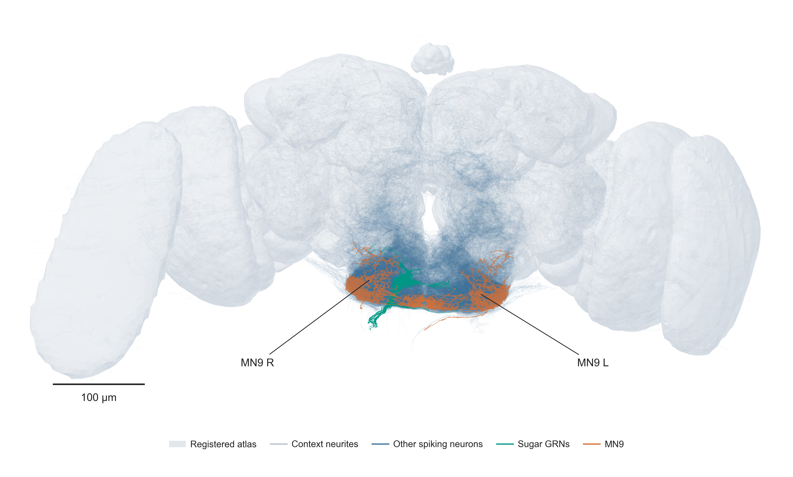

# 果蝇全脑空间中的神经形态视图

2026 年 11 月 17 日。此图从真实神经元骨架重绘，原有模型、连接权重与模拟放电结果保持原样。



**图｜真实神经元形态与模拟实验选中的神经群。**显示 FlyWire v783 的 905 个神经元骨架：本次 1 秒糖刺激模拟中全部 393 个发生放电的神经元，以及从其他模型神经元中按固定空间分层规则选出的 512 个背景样本。蓝色为其余 370 个放电神经元，绿色为 21 个糖感受神经元，橙色为左右 MN9。每条细线均为原骨架中的分支线段，没有用锚点间的直线代替神经突。905 个神经元共保留 4,862,272 条骨架线段；它们不是突触连接数量。颜色表示神经群身份，不表示观测到信号在分支上传播。

浅灰外形是注册到 FlyWire/FAFB14.1 空间的 JFRC2 脑区参考图谱，共 78 个脑区；它不是该标本的 EM 表面。骨架与图谱采用相同坐标空间，nm 换算为 µm 后仅做刚体旋转和正交投影，没有拟合位置、补造分支、平滑或改变原始几何。512 个背景神经元用于展示空间上下文，不用于估计神经密度；完整模拟仍为 138,639 个神经元，本图没有声称显示其全部神经突。

图像提供 [600 dpi PNG](../figures/eon-brain-morphology-20261117.png)、[可编辑 PDF](../figures/eon-brain-morphology-20261117.pdf)、[SVG](../figures/eon-brain-morphology-20261117.svg)及[来源、逐神经元哈希与绘图记录](../figures/eon-brain-morphology-20261117.json)。原先的[空间位置与全部放电量化图](../figures/eon-whole-brain-20261117.png)继续保留。

## 数据来源

- 骨架通过 [fafbseg 官方读取源码](https://fafbseg-py.readthedocs.io/en/latest/_modules/fafbseg/flywire/skeletonize.html)指定的 Cambridge 静态端点，按精确 root ID 获取，版本为 783；二进制格式遵循 [Neuroglancer skeleton 规范](https://github.com/google/neuroglancer/blob/master/src/datasource/precomputed/skeletons.md)。原始研究为 [Schlegel 等，Nature 2024](https://doi.org/10.1038/s41586-024-07686-5)，[补充骨架档案](https://zenodo.org/records/10877326)标注 CC BY 4.0；逐神经元镜像与该档案未作全量字节同一性核验，镜像元数据未另列许可字段，保留 [FlyWire 归属与使用条款](https://flywire.ai/guidelines)，不由第一方声明重新许可。
- 脑区图谱来自 [fafbseg 固定版本数据](https://github.com/navis-org/fafbseg-py/blob/b62bed6572afb98ac6e64e738b8805341e7ee027/fafbseg/data/JFRC2NP.surf.fw.zip)，原图谱见 [JFRC2 neuropil atlas](https://doi.org/10.5281/zenodo.10567)。图中采用其已注册到 FlyWire 空间的坐标。
- 神经群依据[保存的官方 1 秒模拟放电](../../../PoL-Governance/benchmark/fly_brain/official/results/eon-original-20261117/function-1s.parquet)和固定版本 Eon 的糖刺激定义选取，未重跑模型。17,520 次放电、393 个活跃神经元和 MN9 左右 104／65 次的原结果不变。

## 重绘

在仓库根目录运行；下载缓存约 182 MiB，留在模型工作区，不进入 Git：

```powershell
$py = 'D:/Codebase/PoL2-FlyVis-Official/.venv/Scripts/python.exe'
$viz = 'PoL-Governance/benchmark/fly_brain/official'
$work = 'D:/Codebase/PoL2-FlyVis-Official'
& $py "$viz/download_morphology.py" --eon-root "$work/upstream/fly-brain" --coordinates "$work/downloads/flywire-v783-coordinates.csv.gz" --cache-dir "$work/downloads/morphology-v783"
Invoke-WebRequest 'https://raw.githubusercontent.com/navis-org/fafbseg-py/b62bed6572afb98ac6e64e738b8805341e7ee027/fafbseg/data/JFRC2NP.surf.fw.zip' -OutFile "$work/downloads/JFRC2NP.surf.fw.zip"
& $py "$viz/render_morphology.py" --eon-root "$work/upstream/fly-brain" --coordinates "$work/downloads/flywire-v783-coordinates.csv.gz" --cache-dir "$work/downloads/morphology-v783" --atlas "$work/downloads/JFRC2NP.surf.fw.zip"
```

完整保留原骨架点、边与半径并逐项核对缓存；图中线宽只用于区分神经群，没有声称按真实半径显示。背景抽样种子为 20261117，空间网格为 12×8×6，逐格轮转选取；全组 root IDs 与选择规则写入来源记录。PDF 与 SVG 仅将繁密解剖几何作为图像层，文字、图例和比例尺保持可编辑。
