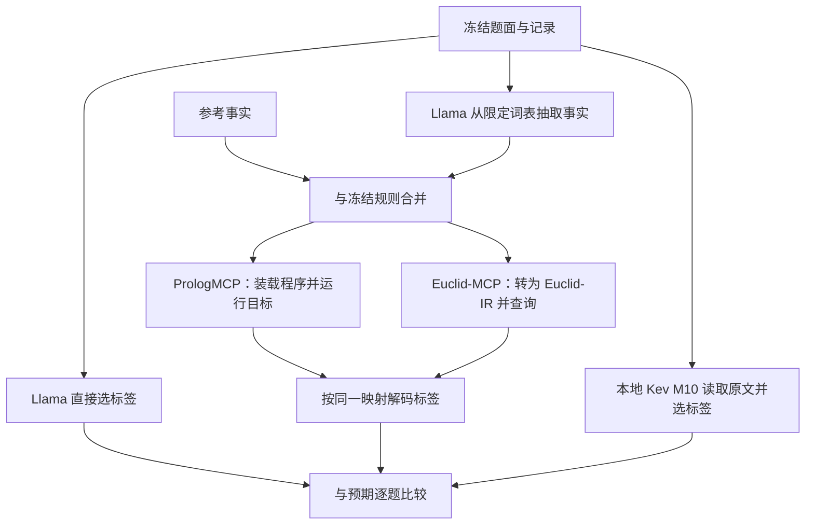

# PrologMCP、Euclid-MCP、Llama 与 Kev M10 的同题对照

2026 年 11 月 19 日。**在 20 道合成题上，两种 MCP 服务读入参考事实都答对了 20 题；改读同一份模型抽取的事实，都只答对 8 题。本地 Llama 直接读题答对 14 题。** 对 PoL 而言，这个差距指出了最值得核查的一步：提交给求解器的每个事实，能否在原始记录里找到主体、范围和出处？本次用同一规则、同一问题重放两种事实，能够定位这一环节的错误。20 题是工程诊断样本，不能据此估计实际治理中的误放率。[逐题并排预测](predictions.csv) · [评分结果](metrics.json) · [复现指南](RUN.md)

## 三类题怎样区分“否”“未知”和“冲突”？

主实验用 20 道英文合成题。每题冻结题面、选项、参考事实、规则、查询及预期标签。发布声明与动物属性分别查询支持正反两种判断的证据，因而可以同时表示未知和冲突。档案权限题则明确规定登记册完整，查不到可推导授权时答否。答案选项按题号轮换。题目和参考事实由同一个生成脚本保存，未经过独立盲标；完整规则、主体范围和事实词表均已给定。[全部题面与标签](cases.json) · [题集生成脚本](make_cases.py)

| 题组 | 数量 | 题目要求 |
|---|---:|---|
| 测试与发布声明 | 8 | 判断 A 声称“全部通过”是否有依据。仅静态检查为 REVISE，全量通过为 CONTINUE，两种记录都有为 CONFLICT，都没有为 UNKNOWN。CONTINUE 只表示继续其他检查。 |
| 动物属性 | 6 | 判断 Pip 是否有毛皮。须区分类别继承与实际观察，并区分 Pip 和 Max。允许 UNKNOWN 与 CONFLICT。 |
| 档案借阅权限 | 6 | 从完整名册判断 Ada 能否借地图集。区分角色继承、直接授权、他人的权限，以及尚未生效的申请。 |

另有一组独立的回放，直接使用 Euclid 论文表 2 的五道原题及作者的参考程序。两个服务各得 **5/5**；这里没有让模型把题面翻译成程序。11 月 18 日归档的 Llama 8B 自行填写事实的 Euclid 复现为 **4/5**，错在鹰的毛皮题。原题回放、历史复现和本次新编 20 题分别统计。[五题输入、响应与评分](paper-five/README.md) · [论文与历史复现的差异](sources.md)

## 同一份规则如何接收两种事实？

参考事实组测量给定正确前提后的推导。模型抽取组用同一个 Llama、同一候选词表产生事实，写入文件后分别交给两种服务，因此两条路径收到相同输入。PrologMCP 接收 Prolog 文本；Euclid-MCP 接收转换后的 Euclid-IR，两者都实际通过本地标准输入输出调用服务，底层共享 SWI-Prolog 10.0.2。模型没有编写规则、选择查询或根据错误重试。这项比较检验固定规则下的抽取与执行，不能代表完整的自主形式化智能体。[MCP 请求与转换代码](mcp_runner.py) · [两套接口与上游来源](sources.md)

直接回答与抽取都使用本地 Ollama 0.34.2 的 Llama 3.1 8B（Q4_K_M），温度 0、种子 42、上下文 2,048、最多生成 160 个 token。模型只读题面和本次任务允许输出的选项或原子谓词。探索性的“仅记录”条件只给抽取器案件叙述，移除题面中的政策文字，后续仍使用相同的固定规则。Kev M10 是本地候选选择模型，直接读原始题面，用 CPU 对候选项评分。按本次选用本地方案的范围，TypeSafe **Jev 未运行，成绩为 N/A**；Kev 的成绩单独列示。[Llama 配置](llm_meta.json) · [输入构造与输出校验](llm_runner.py) · [Kev 运行脚本](run_kev.py) · [Jev 接口与用途](sources.md)

## 参考事实让两种服务逐题一致，自动抽取拉低了分数

| 输入与方法 | 全部 /20 | 发布 /8 | 动物 /6 | 权限 /6 | p50 / p95，毫秒 |
|---|---:|---:|---:|---:|---:|
| Llama 直接读题 | 14 | 6 | 4 | 4 | 130.6 / 155.9 |
| 参考事实 → PrologMCP | 20 | 8 | 6 | 6 | 58.1 / 60.2 |
| 参考事实 → Euclid-MCP | 20 | 8 | 6 | 6 | 100.3 / 208.4 |
| Llama 抽取 → PrologMCP | 8 | 4 | 1 | 3 | 447.5 / 616.1 |
| Llama 抽取 → Euclid-MCP | 8 | 4 | 1 | 3 | 503.4 / 599.6 |
| 仅记录抽取 → PrologMCP | 11 | 4 | 4 | 3 | 458.3 / 572.5 |
| 仅记录抽取 → Euclid-MCP | 11 | 4 | 4 | 3 | 516.5 / 667.2 |
| Kev M10 直接读题（CPU） | 17 | 6 | 6 | 5 | 26,580 / 49,464 |

Kev 使用此前已选定的 score-v2 M10 seed-43 检查点，底座为 Qwen3.5-4B-Base。本次在 CPU 上以 BF16、6 线程实际运行，逐题保存候选标签及其概率。它答对全部 6 道动物题，错例为两条发布声明和一条权限题。中位耗时约 26.6 秒，计入编码与前向计算，未计入一次性模型加载。各路径的硬件利用方式、模型运行时和计时范围不同，这些数值只描述此次本地执行。[模型版本、权重摘要与逐题输出](kev-m10.json)

上表按最终标签精确匹配评分，缺失响应按错误计。两种服务在每个抽取条件下不仅总分相同，逐题预测也一致。计时来自本机单次运行：参考组记录每题的服务调用，混合组把先后保存的抽取耗时和该题的服务耗时相加。p50 为中位数，p95 取排序后的第 19 个样本，均不代表线上吞吐。主实验没有使用发布系统的真实请求。[分组统计与时间](metrics.json) · [逐题预测](predictions.csv) · [计分代码](score.py)

参考答案共含 30 个“案件—事实”配对。含政策的抽取找回 29 个，漏 1 个，**额外添加 46 个**，只有 2/20 题的整个事实集合完全正确。仅给记录时仍找回 29 个，额外添加降至 34 个，完全正确增至 4/20。两组均无格式无效响应。移去政策文字后，动物题由 1/6 升至 4/6；发布和权限题的总分没有提高，发布题还有原本答对而改错的情况。该变化值得在新题集上检验。即使最终标签碰巧答对，写入知识库的其他错误事实仍会污染后续查询。[原始模型输入输出](llm_raw.jsonl) · [仅记录条件的输入输出](record_only_llm_raw.jsonl) · [事实对照统计](metrics.json)

## 从一条证明追到错误前提

`animal-03` 的原记录写着 *Pip is an eagle. Max is a mammal.* 候选词表中与记录匹配的只有 `mammal(max)`，按本题规则无法推出 Pip 有毛或无毛，预期为 UNKNOWN。抽取器却写入了 `lynx(max)`、`lynx(pip)`、`mammal(max)`、`mammal(pip)` 四项。Euclid 的真实响应给出的证明只用两步：查询 `fur(pip)` 命中“哺乳动物有毛”规则，子证明直接引用 `mammal(pip)` 这个事实。PrologMCP 也推出 FUR。复核者沿着这条证明看回原句，能立即指出错误前提把 Max 的分类加到了 Pip 身上。[抽取后的知识库](extracted_cases.json) · [Euclid 完整证明](raw/hybrid/euclid.json) · [Prolog 查询响应](raw/hybrid/prolog.json)

如果规定“直接回答与模型抽取后的 Prolog 判断一致就接受，分歧才复核”，20 题中有 10 题进入复核，另外 10 题只有 **7 题同意且正确、3 题同意却错误**。除上述动物题外，`roles-04` 把未来的角色申请判为已有权限，`roles-06` 在只有 Ben 获批时判定 Ada 可以借阅。这两条路径共享同一个读题模型，两个规则服务又可共享同一份错误事实。因此，同意率必须与“同意且错”的案件一起报告。[逐题一致性与错例](predictions.csv) · [一致性统计](metrics.json)

再要求 Kev M10 也同意，接受数由 10 降到 **7/20**，须复核 **13/20**；接受的 7 题里有 6 题正确，仍保留一个共同错例。在 `roles-04`，Ben 现任档案员并拥有直接授权，Ada 仅申请明年担任主管。正确答案为 NO；Llama 直接回答、Llama 抽取后推导和 Kev 都答 YES，Kev 还给这个错误选项分配了 **99.78%** 的候选概率。提高一致性要求在此减少了两个共同错误，也多转送了一道正确题。单次高分和三方一致，均无法验证 Ada 已获授权。[三方逐题结果](predictions.csv) · [Kev 概率与原始 logits](kev-m10.json)

## 对 PoL 的适用范围

本次发布题把“不是该次运行的日志”“只是计划”“收到矛盾记录”等情况明确写进了题面。适合先在只读旁路保留逐条证据来源，让复核者在同一界面看到原记录、抽取的原子事实和命中规则。对于参考事实已核验的案件，两种服务都能重放本题集的判断；输入交给模型抽取以后，对一致结论仍要抽查前提。后续若要据此决定接入，应使用独立标注的保留案件，特别检验错误主体、撤回、范围过期和缺证时的误放，并分别测量抽取、规则和人工复核成本。[PoL 规则适配与治理流程](../README.md)
