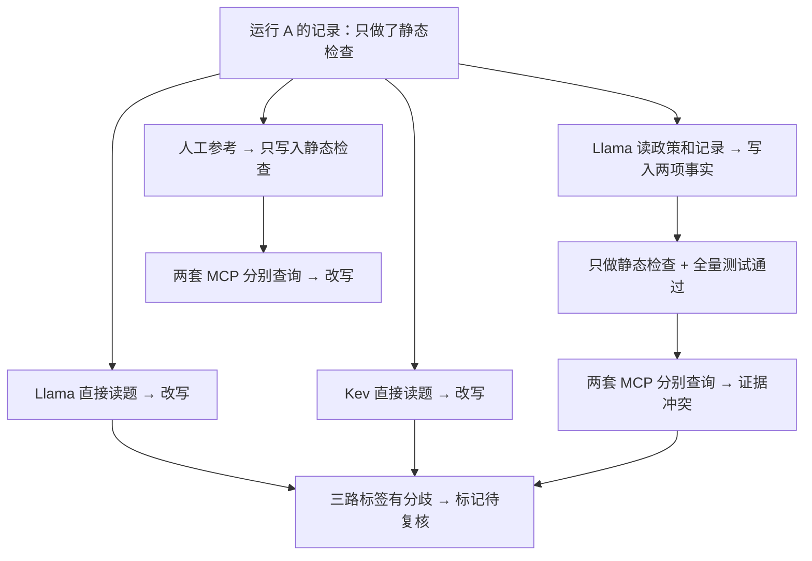

# 同一道题，模型直接判断和调用 Prolog 会给出什么答案？

NaturalDAO 本地对照实验 · 2026 年 11 月 19 日

一份记录只写了“做过静态检查”，智能体却报告“所有测试都通过了”。要判断这句话是否需要修改，可以让模型直接读记录，也可以让模型先把记录写成事实，再交给规则引擎推导。这个实验想弄清楚：**如果两条路径给出不同结论，差异发生在读记录时，还是执行规则时？**

## 实验结果

我们用同一组 20 道英文合成题比较这两步。Llama 直接读题答对 **14/20**，NaturalDAO 的本地判别模型 Kev M10 答对 **17/20**。两套 Prolog 服务在给定人工参考事实时各答对 **20/20**；换成 Llama 自动抽取的事实，固定规则和查询，两个服务都降到 **8/20**。这一对照表明，在本题集和这套抽取提示下，首先值得核查的是模型把哪些内容写成了事实。[逐题答案](predictions.csv) · [汇总指标](metrics.json)

| 谁来读记录 | 谁给出最终标签 | 全部 | 测试声明 | 动物属性 | 借阅权限 |
|---|---|---:|---:|---:|---:|
| Llama 3.1 8B | Llama 直接选答案 | 14/20 | 6/8 | 4/6 | 4/6 |
| Kev PoL2 M10 | Kev 直接选答案 | 17/20 | 6/8 | 6/6 | 5/6 |
| 使用人工参考事实 | PrologMCP、Euclid-MCP 分别推导 | 各 20/20 | 各 8/8 | 各 6/6 | 各 6/6 |
| Llama 同时读政策和记录，抽取事实 | 两套 MCP 分别推导 | 各 8/20 | 各 4/8 | 各 1/6 | 各 3/6 |
| Llama 仅读记录，抽取事实（探索性对照） | 两套 MCP 分别推导 | 各 11/20 | 各 4/8 | 各 4/6 | 各 3/6 |

每格为答对题数／题数。两套 MCP 服务接收同一份事实，底层都用 SWI-Prolog，在上述每种条件下逐题结果均相同。人工参考组隔离了规则执行这一步，不能把它的满分当作从自然语言自动判断的准确率。**TypeSafe 官方 Jev 未运行**；Kev 是 NaturalDAO 自有模型。[实验输入](cases.json) · [模型版本与权重摘要](kev-m10.json)

## 把一道题走完

`release-01` 问的是：针对运行 A，助手声称所有测试均已通过，记录却只确认做过静态检查，是否应修改报告？参考答案是 **REVISE（改写）**。下图每条路径上的标签均来自该题的归档输出。



抽取器多写了 `full_pass(a)`（A 的全量测试通过）。求解器收到的两条事实分别支持“改写”和“继续其他检查”，因此给出 **CONFLICT（证据冲突）**。探索性对照中，把政策段从抽取提示中拿掉，这一道题恢复为 REVISE。三路一致性分析使用原先“政策和记录都可见”的抽取结果；图中的“待复核”是离线标记。[模型实际收到的提示与回答](llm_raw.jsonl) · [仅给记录时的回答](record_only_llm_raw.jsonl)

在本目录运行下面的命令，可以看到该题的原文、两种模型的直接答案、三种事实输入、两个 MCP 的每次查询结果，以及最终是否标记复核。脚本只读取已归档的响应，使用 Python 标准库；把题号换成 `animal-03` 或 `roles-04` 即可查看后文的两个错例。[单题回放代码](trace_case.py)

```bash
python trace_case.py release-01
```

## 各条路径的决策代码

下面按数据流给出实际实现的核心片段。为便于阅读，省略初始化与写日志，保留决定输出的参数、分支和解码方式。运行完整实验的命令见[复验指南](RUN.md)。

### 1. Llama：直接选答案，或只负责写事实

同一个 Llama 有两种任务。直接作答时，JSON 字段 `label` 只能填题目允许的标签；抽取时，字段 `facts` 只能填词表内的事实。两次调用各自读题，抽取器看不到直接作答的答案。下面的 `raw` 是本地 Ollama 返回的响应。完整代码还检查生成是否完成、标签是否有效、事实是否在词表内。[模型请求与响应校验](llm_runner.py)

```python
# 组装用户提示。record_only 仅用于探索性的抽取对照。
visible = case["text"].split("\nRecord: ", 1)[1] if record_only else case["text"]
field = "label" if mode == "direct" else "facts"
choices = case["labels"] if mode == "direct" else case["vocabulary"]
prompt = visible + "\nAllowed " + field + ": " + json.dumps(choices)

# 从 /api/chat 的 JSON 回答取结果
answer = json.loads(raw["message"]["content"])[field]
if mode == "direct":
    prediction = answer
else:
    facts = sorted(set(answer))
    knowledge = "\n".join(case["rules"] + [atom + "." for atom in facts])
```

人工参考组直接读取题库中的 `case["knowledge"]`。模型抽取组用上面生成的 `knowledge`；两个组沿用同样的规则和目标。模型无需自己编写规则。

### 2. 两套 MCP：分别问哪些结论有证据支持

以测试声明题为例，下面是与运行 A 有关的 Prolog 程序。原始知识库还包含两个使用 `dummy` 的占位事实，以保证没有观测记录时谓词仍可查询；它们不会匹配 A。[完整题目与规则](cases.json)

```prolog
static_only(a).                         % 记录确认了这项事实
revise(X) :- static_only(X).            % 仅做静态检查，支持改写
continue_checks(X) :- full_pass(X).     % 全量通过，支持继续其他检查
```

每次先查 `revise(a)`，再查 `continue_checks(a)`。用 1 表示能推出该目标，用 0 表示正常执行后没找到证明。两个目标依次得到的位串由题库解码：**10 → 改写，01 → 继续其他检查，00 → 缺证，11 → 冲突**。下面是两套接口的查询写法，`call` 为实验客户端的异步 MCP 调用函数；错误或超时单独记录，不能算作 0。[客户端、转换器与错误处理](mcp_runner.py)

```python
# PrologMCP：本案装载一次程序，同一会话内依次查询。
loaded = await call("create_session", {"source_text": knowledge})
load_id = loaded["load_id"]
try:
    bits = []
    for goal in case["goals"]:
        r = await call("run_goal", {"load_id": load_id, "goal": goal,
                                   "time_limit": 30, "max_answers": 1})
        if not r["ok"] or r["outcome"] not in ("success", "failure"):
            raise ValueError(r)
        bits.append("1" if r["outcome"] == "success" else "0")
    prediction = case["decode"]["".join(bits)]
finally:
    await call("close_session", {"load_id": load_id})
```

```python
# Euclid-MCP：同一份程序转为 Euclid-IR，每次查询都传入该程序。
ir = euclid_program(knowledge)
bits = []
for goal in case["goals"]:
    r = await call("reason", {"knowledge": ir, "query": goal,
                              "max_solutions": 1, "max_depth": 30})
    if r.get("error") or r["query"] != goal or not isinstance(r["solutions"], list):
        raise ValueError(r)
    bits.append("1" if r["solutions"] else "0")
prediction = case["decode"]["".join(bits)]
```

这里每个查询只问“是否有证明”，所以最多取一个解。PrologMCP 要读 `outcome`：查询里没有待绑定变量时，成功也可以返回空的 `answers`。Euclid 的解附带证明，可沿证明回看使用了哪条事实。[PrologMCP 原始返回](raw/hybrid/prolog.json) · [Euclid 原始返回及证明](raw/hybrid/euclid.json)

### 3. Kev M10：对题目的候选标签评分

Kev 直接接收题目原文和候选标签。模型为每个候选项产生一个分数（logit），最高分对应最终标签；softmax 给出该组候选项的概率。本实验保存了两者。[完整推理代码](run_kev.py) · [逐项分数与概率](kev-m10.json)

```python
req = SystemOneRequest(state=case["text"], questions={"decision": {
    "type": "choice", "instructions": "Select the answer to the question in the state.",
    "criteria": {label: None for label in case["labels"]}}})
record, meta = to_record(req)
with torch.inference_mode():
    enc = model.encode(tok, record, max_state=4096, max_branch=4096, strict=True)
    logits = model.forward(enc)[0].float().cpu()
keys = meta[0]["keys"]
prediction = keys[logits.argmax().item()]
probabilities = dict(zip(keys, torch.softmax(logits, -1).tolist()))
```

### 4. 合并判断：记录一致标签，分歧转入复核

下面的 `hybrid` 专指“Llama 从政策和记录抽取事实 → PrologMCP 推导”的标签。Euclid 对相同输入逐题给出相同结果，合并时只计一次。两路和三路是两项各自统计的离线分析。[评分与一致性代码](score.py)

```python
def agreement(*labels):
    first = labels[0]
    if first is not None and all(label == first for label in labels):
        return first
    return "REVIEW"

two_way = agreement(llama_direct, hybrid)
three_way = agreement(llama_direct, hybrid, kev_direct)
```

| 判定方式 | 得到一致标签 | 其中答对 | 其中答错 | 标记复核 |
|---|---:|---:|---:|---:|
| Llama 直接作答 + 抽取后推导 | 10/20 | 7 | 3 | 10 |
| 上述两路再加 Kev | 7/20 | 6 | 1 | 13 |

三路都判错的是 `roles-04`。Ben 已获借阅权限；Ada 只是申请明年担任主管。正确答案是 Ada **没有**权限。三路却都给出 YES，Kev 对 YES 给出 99.78% 的候选概率。对 PoL，这一例说明了复核时该查什么：授权给了谁、何时生效、能否在原记录找到对应条目。[三路逐题输出](predictions.csv) · [Kev 原始概率](kev-m10.json)

## 错误来自哪里，哪些结论可以外推？

在 20 题的候选词表内，人工参考一共列出 30 项“案件—事实”配对。抽取器同时读政策和记录时，找回 29 项，却额外写入 46 项，只有 2 题的事实集合完整匹配。只读记录时，仍找回 29 项，额外写入降至 34 项，完整匹配增至 4 题。最终标签多答对的 3 题体现在动物题组；测试声明和权限题组的正确数都未增加。[事实匹配统计](metrics.json)

例如 `animal-03` 原文只说 Pip 是鹰、Max 是哺乳动物。按题设规则，Pip 是否有毛皮应为 UNKNOWN。抽取器却把 `mammal(pip)` 也写入了知识库。Euclid 的证明据此从“哺乳动物有毛皮”推出 Pip 有毛皮。证明能解释引擎为什么这样回答，核对原句才能发现它用错了主体。[抽取的事实](extracted_cases.json) · [逐步证明](raw/hybrid/euclid.json)

**适用范围。** 题目覆盖测试声明、动物分类、档案权限三类场景。前两类允许证据不足或冲突，权限题则明示名册完整，查不到授权即可答 NO。题目与预期标签由项目整理，选项顺序轮换，没有独立盲标，也没有真实审批请求。结果适合定位工程错误。估计真实 PoL 的误放率、误拦率和复核成本，仍需独立标注的保留案例。[题集生成方法](make_cases.py) · [PoL 接入设计](../README.md)

**论文原题单列。** 另用 Euclid 论文表 2 的五道原题及作者提供的参考程序回放，两套 MCP 服务均得 5/5。11 月 18 日的历史复现中，由 Llama 自行填写事实再交给 Euclid 时为 4/5，错在鹰的毛皮题。两次测量的输入不同，均单独于本次 20 题计分。[原题逐项回放](paper-five/README.md) · [论文与历史复现说明](sources.md)

<details>
<summary>运行环境、延迟和复验命令</summary>

Llama 3.1 8B 使用 Ollama 0.34.2、Q4_K_M、温度 0、seed 42，上下文 2,048，最多生成 160 token。Kev 使用基于 Qwen3.5-4B-Base 的 PoL2 M10 发布版默认 seed-43，CPU BF16、6 线程。PrologMCP 固定提交 `4ae536f`，Euclid-MCP 固定提交 `aed1017`，两者共享 SWI-Prolog 10.0.2。[模型配置](llm_meta.json) · [权重摘要](kev-m10.json) · [两套服务的环境与启动参数](RUN.md)

| 单题耗时，毫秒（p50 / p95） | 直接作答 | 人工参考事实 | 政策和记录抽取 | 仅记录抽取 |
|---|---:|---:|---:|---:|
| Llama | 130.6 / 155.9 | — | — | — |
| Kev | 26,580 / 49,464 | — | — | — |
| PrologMCP | — | 58.1 / 60.2 | 447.5 / 616.1 | 458.3 / 572.5 |
| Euclid-MCP | — | 100.3 / 208.4 | 503.4 / 599.6 | 516.5 / 667.2 |

p50 为中位数，p95 取 20 次观测按耗时排序后的第 19 项。混合路径将同题抽取与 MCP 调用的实测耗时相加。Kev 的计时包括编码和前向计算，不含一次性加载。硬件利用方式和计时边界不同，不能由此估算线上吞吐。[计时口径与原始汇总](metrics.json)

```bash
python trace_case.py release-01   # 从归档响应重建一题的决策过程
python score.py                   # 从归档响应重算全表
```

重新运行模型和两套 MCP 所需的安装、版本、数据文件及命令见[完整复验指南](RUN.md)。

</details>
