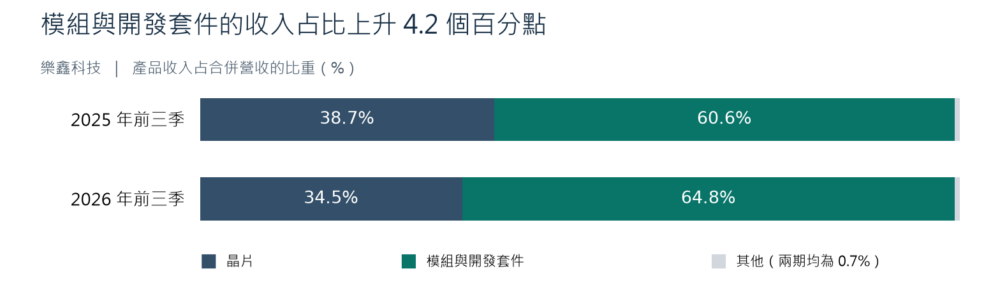
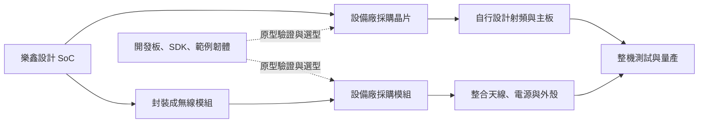

# 樂鑫科技（ESP32）產業調研

更新於 2026 年 11 月 18 日。財務資料截至 2026 年 9 月 30 日，金額均為人民幣。

**買 ESP32 的客戶，買的是一顆晶片，還是已經能連網的一塊模組？** 對樂鑫而言，後者帶來的收入更多。2026 年前三季，模組與開發套件占營收 **64.8%**，同比增長 **32.5%**；單售晶片占 **34.5%**，同比增長 **10.4%**。對設備廠而言，兩條路的差別在於射頻設計、軟體整合和後續維護要自己承擔多少。下文從這個採購決定出發，追到終端產品和可以直接閱讀的韌體。[樂鑫 2026 年三季報，第 7–8 頁][q3]

[📊 營收與供應鏈](#industry) · [🔌 終端拆解](#devices) · [🧩 晶片選型](#chips) · [💻 GitHub 專案](#projects) · [🔎 競爭與追蹤](#watch)

## 📊 樂鑫靠什麼取得收入？

樂鑫（688018.SH）是無晶圓廠半導體設計公司。它以 SoC 形式出售運算與無線連接能力，也把晶片、射頻電路等整合成模組出售。公司將開發板與模組列在同一收入項下。這個分類可以比較兩條銷售路徑，但無法單獨算出開發板銷售額或愛好者對收入的貢獻。[公司三季報，第 3、8、13 頁][q3]

*圖 1　同為 1 至 9 月的收入組成。晶片收入仍在增長，其占比下降源於模組及開發套件增長更快。兩期都只計樂鑫營收。* [資料來源，第 8 頁][q3]

| 合併財務指標 | 2023 全年 | 2024 全年 | 2025 全年 | 2026 年 1–9 月 |
|---|---:|---:|---:|---:|
| 營業收入（億元） | 14.33 | 20.07 | 25.65 | 23.70 |
| 歸母淨利（億元） | 1.36 | 3.39 | 4.98 | 5.53 |
| 綜合毛利率（約） | 40.6% | 43.9% | 46.6% | 50.0% |

2026 年前三季歸母淨利同比增長 46.8%，經營活動現金流淨額為 3.18 億元。公司解釋，記憶體漲價及交期拉長促使其備貨，期末存貨較上年末增加 2.92 億元。評估模組業務時，毛利率和備貨占用的資金都要看。表中最後一欄只有九個月。[2024 年報][ar24] · [2025 年報][ar25] · [2026 年三季報，第 6–8 頁][q3]

### 從開發板走向採購單

*圖 2　兩種設計導入路徑。模組可沿用部分既有射頻設計與認證成果，整機廠仍須按天線配置和銷售地核對適用條件。圖為依公司業務說明整理的流程示意。* [樂鑫三季報，第 8、13 頁][q3]

樂鑫於 2024 年取得 M5Stack 多數股權。以 CoreS3 為例，開發者能在同一塊板上測試螢幕、相機與聲音，先判斷應用能否成立，再決定是否自製主板。這說明樂鑫為何投資開發工具；一款套件究竟帶來多少後續模組訂單，公司並未按套件披露。[收購公告](https://www.espressif.com/en/news/Espressif_Acquires_M5Stack) · [CoreS3 硬體文件](https://docs.m5stack.com/en/core/CoreS3)

## 🔌 三種終端，三種採購理由

| 終端與證據 | ESP32 在系統中的位置 | 從整機能看出什麼 |
|---|---|---|
| **能源計量** · Shelly Pro 3EM，導軌式三相電表 | 廠商列出的 CPU 是 ESP32-D0WDQ6。整機提供 LAN、Wi-Fi 和 Modbus，可在本地讀取電力資料。 | 樓宇整合商可以沿用有線網路與既有監控系統。評估產品時，應分別查閱整機計量精度、通訊介面與斷網記錄能力。[硬體規格](https://www.shelly.com/es/blogs/documentation/shelly-pro-3em) · [產品頁](https://www.shelly.com/products/shelly-pro-3em-x1) |
| **家庭語音** · Home Assistant Voice Preview Edition，公開硬體及韌體的成品 | ESP32-S3 配 8 MB PSRAM，另有 XMOS XU316 處理回音消除與噪音。語音助理還可接 Home Assistant 主機或雲端服務。 | 計算分布在麥克風前端、裝置與後端。估算「AI 終端」成本時，應把音訊晶片、連線與後端推理分開計。[整機規格](https://www.home-assistant.io/voice-pe/) · [韌體](https://github.com/esphome/home-assistant-voice-pe) |
| **互動面板與原型** · M5Stack CoreS3，開發套件 | ESP32-S3 驅動顯示、觸控及周邊。M5Unified 提供共用介面，方便在多款板上重用程式。 | 設備商可先驗證人機介面與周邊，再自製主板。套件可購得，只能證明工具成熟度，無法據此推算工業裝機量。[板卡規格](https://docs.m5stack.com/en/core/CoreS3) · [M5Unified](https://github.com/m5stack/M5Unified) |

樂鑫在 2025 年報中披露，智慧家居收入同比增長逾 20%，工業與能源管理相關應用也有較強增長。以上案例提供可核實的具體用途，公開資料尚不足以把樂鑫營收分攤到這三款設備。[2025 年報，第 9 頁][ar25]

## 🧩 晶片選型先看無線與主控如何分工

| 家族 | 連接與運算 | 適合拿來驗證的設計問題 |
|---|---|---|
| ESP8266、經典 ESP32 | 前者為 Wi-Fi；經典 ESP32 支援 Wi-Fi、傳統藍牙與 BLE | 維護既有設計時，先查是否依賴傳統藍牙、特定封裝或周邊腳位，再估移植工時。 |
| C2、C3、C61 | C2/C3 整合 2.4 GHz Wi-Fi 與 BLE；C61 提供 2.4 GHz Wi-Fi 6 | 插座、家電連網板先核對快閃容量、韌體更新空間與模組報價。 |
| C6、C5 | Wi-Fi 6、BLE、802.15.4；C5 另支援 5 GHz Wi-Fi | 家庭中樞若要連 5 GHz 網路，可先試 C5；Matter 裝置須先選擇 Wi-Fi 或 Thread 傳輸。 |
| H2、H4、H21 | BLE 與 802.15.4，無內建 Wi-Fi | 電池感測器採 Thread 時，核算喚醒週期及邊界路由器的部署條件。 |
| S3、S31 | S3 適合顯示及音訊前端；S31 整合 Wi-Fi 6、藍牙及 802.15.4 | 有螢幕或麥克風的裝置，要在所選板卡上量測顯示更新、收音與連網同時運行的表現。 |
| P4 | 應用處理器，提供相機與顯示介面，無內建無線電 | 智慧屏需要無線時，須把連接晶片、主機介面及雙端韌體都算進設計。 |
| E22 | 三頻 Wi-Fi 6E 無線協處理器，搭配主機 | 已有應用主機且要導入 6 GHz 時，核對主機介面、驅動及目標市場頻段。 |

表列家族涵蓋量產設計與較新發布的型號。實際導入以確切料號的資料表、可採購模組及 SDK 支援版本為準。Matter 定義應用層，Thread 使用 802.15.4 無線電；BLE 常用於初次配網。[公司晶片矩陣，第 10 頁][q3] · [ESP-Matter 文件與範例](https://github.com/espressif/esp-matter) · [產品目錄](https://www.espressif.com/en/products/socs)

## 💻 GitHub 專案地圖

這十個專案各對應一項設備開發工作。閱讀順序取決於問題：要確認某款成品如何運作，可直接從韌體庫開始；要判斷另一顆 ESP32 能否接手，則從底層框架的目標晶片清單開始。

| 專案／維護方 | 能回答的問題 | 第一個值得看的地方 |
|---|---|---|
| [ESP-IDF](https://github.com/espressif/esp-idf) · 樂鑫 | 某顆晶片在哪個框架版本支援所需周邊？ | README 的版本支援表，再按目標晶片找 examples。 |
| [Arduino-ESP32](https://github.com/espressif/arduino-esp32) · 樂鑫 | 現有 Arduino 函式庫能否沿用？ | 先核對支援的 SoC，再比對函式庫範例與實際開發板。 |
| [ESP-Matter](https://github.com/espressif/esp-matter) · 樂鑫 | 燈具或開關如何向 Matter 控制器公開功能？ | 從燈具範例辨認裝置端點、資料模型與配網方式。 |
| [ESP-Modbus](https://github.com/espressif/esp-modbus) · 樂鑫 | 如何把儀表的暫存器接入監控系統？ | 對照串列與 TCP 範例，確認主從角色和暫存器映射。 |
| [ESP-Hosted](https://github.com/espressif/esp-hosted) · 樂鑫 | 已有 Linux 或 MCU 主機，如何外掛無線能力？ | 先按主機平台選實作，再查主機與協處理器之間的介面。 |
| [ESP-DL](https://github.com/espressif/esp-dl) · 樂鑫 | 哪些模型運算可以留在裝置端？ | 核對目標晶片與支援的算子，再用自己的模型量測延遲及記憶體。 |
| [M5Unified](https://github.com/m5stack/M5Unified) · M5Stack | 換一款板卡，顯示與輸入程式能重用多少？ | 先讀支援機型，再看板載周邊的共用 API。 |
| [ESPHome](https://github.com/esphome/esphome) · ESPHome 社群 | 感測器如何用宣告式配置接入 Home Assistant？ | 從一個元件的配置與實作，追到目標板的韌體建置。 |
| [Home Assistant Voice PE](https://github.com/esphome/home-assistant-voice-pe) · ESPHome | 真正的語音成品如何組合按鍵、燈光與音訊？ | 對照產品頁與板級配置，分辨 ESP32 和音訊處理器的職責。 |
| [小智 xiaozhi-esp32](https://github.com/78/xiaozhi-esp32) · 社群 | 聯網對話裝置如何分配端側與服務端工作？ | 從支援板卡與通訊協議讀起，追一次語音上傳與回應播放。 |

兩個適合交叉閱讀的例子：**家庭語音**可從 Voice PE 成品追到 ESPHome，判斷哪些功能可移植，哪些依賴專用硬體。**能源監測**可把 Shelly 公開的通訊介面與 ESP-Modbus 範例並讀，理解同類設備如何接入樓宇系統；Shelly 是否採用該函式庫，產品文件並未披露。

## 🔎 同一張採購單上，ESP32 會遇到誰？

| 採購情境 | 可比方案 | 影響選擇的條件 |
|---|---|---|
| 新設計，需要 Wi-Fi 6、BLE 與 Thread | ESP32-C5/C6；恩智浦 RW612 整合三種無線電與 Cortex-M33 | 先確定頻段，再比較既有程式能重用多少、模組供應與認證工時。[RW612 規格](https://www.nxp.com/products/RW612) |
| 既有主控要增加 Wi-Fi | ESP-Hosted 搭配樂鑫無線 SoC；Nordic nRF7002 搭配既有主機 | 同時計入主機與無線晶片待機電流、介面占用、主機驅動維護成本。[ESP-Hosted](https://github.com/espressif/esp-hosted) · [nRF7002 規格](https://www.nordicsemi.com/products/nrf7002) |
| 電池供電的 Wi-Fi 設備 | ESP32-C 系列；Silicon Labs SiWx917 支援單晶片或外掛主機架構 | 在相同上報間隔與訊號條件下，比較喚醒、重連及傳完資料的總耗電。[SiWx917 技術說明](https://www.silabs.com/documents/public/presentations/wf-202-low-power-wi-fi-applications-for-home-and-building-automation.pdf) |

樂鑫在三季報中將自身列為全球 Wi-Fi MCU 市場領先者，並披露累計 IoT 晶片出貨逾 15 億顆。累計出貨跨產品、跨年度；估算某年市占率還需要同年、同品類的全球出貨分母。原稿採用的約 27% 缺少可重算的分子與分母，本文保留可查的公司披露。[三季報，第 3 頁][q3]

### 下次財報值得追的三件事

- **模組增長能否轉成現金？** 並列觀察模組收入增速、綜合毛利率、存貨和經營現金流。備貨增加時，毛利改善與現金回收可能出現在不同季度。
- **新晶片走到了哪一步？** 對 S31、P4 及後續 Wi-Fi 產品依次記錄資料表、SDK 正式支援、可購模組、具名終端。只有取得客戶或公司披露的出貨資料後，才估算收入貢獻。
- **開源工具有沒有進入持續維護的產品？** 追蹤版本支援年限、板級韌體更新與已公開的硬體型號。GitHub 收藏數反映關注度，營收仍須回到公司報表核對。

原稿的股價與市值快照取自 2026 年 11 月 5 日，2027 年三種估值情境依賴作者自設的盈利和本益比。欲對照原假設、逐季數據與完整風險表，可讀[原始版本（固定提交）](https://github.com/naturaldao/NaturalDAO-2nd/blob/d8c17c3fc628a7b2d325752ca363df0904e98a12/Research/Storage/04-调研笔记/乐鑫科技（ESP32）调研报告)。

[q3]: https://www.espressif.com/sites/default/files/financial/688018_%E4%B9%90%E9%91%AB%E7%A7%91%E6%8A%80_2026-10-24_%E4%B9%90%E9%91%AB%E7%A7%91%E6%8A%80%EF%BC%9AEspressifSystemsQ32026Report.pdf
[ar25]: https://www.espressif.com/sites/default/files/financial/Espressif%20Systems%202025%20Annual%20Report.pdf
[ar24]: https://www.espressif.com/sites/default/files/financial/688018_20250322_Espressif%20Systems%202024%20Annual%20Report.pdf
